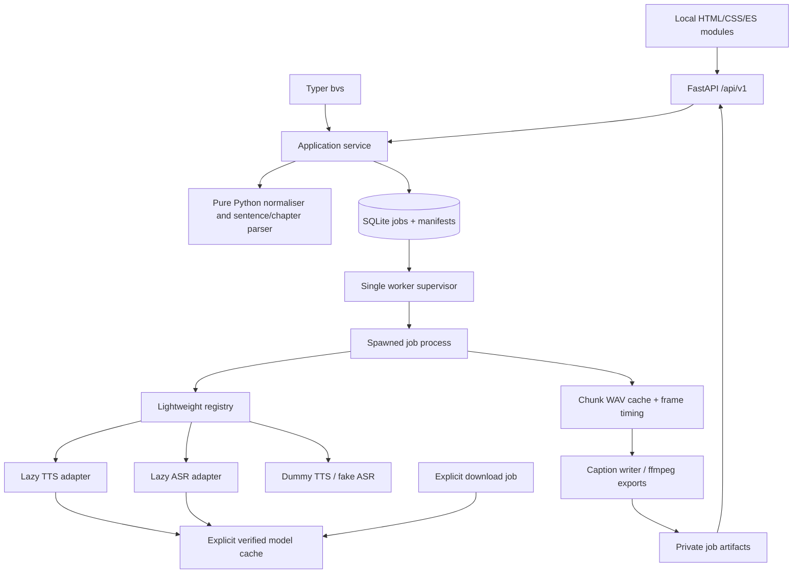

# Bangla Voice Studio Implementation Plan

> **For agentic workers:** REQUIRED SUB-SKILL: Use superpowers:subagent-driven-development or superpowers:executing-plans to implement this plan task-by-task, when implementation is separately requested. Steps use checkbox (`- [ ]`) syntax for tracking. This handoff authorizes planning only.

**Goal:** Ship one complete local Bangla narration workflow: prepare text, preview speech, optionally use a reference voice, render a book, and export audio with captions.

**Architecture:** A pure-Python text layer and typed engine contracts feed one application service shared by Typer and FastAPI. A SQLite job queue supervises one worker process at a time; adapters load model libraries only inside that worker. FastAPI serves local HTML, CSS, JavaScript, and fonts without a frontend build.

**Tech Stack:** Python 3.11/3.12; distribution `bangla-voice-studio`, import package `bvs`, command `bvs`; FastAPI/Pydantic v2, Uvicorn, Typer, SQLite/stdlib, pytest, Ruff, mypy, Python Playwright, ffmpeg/ffprobe. Model libraries are optional extras.

**Spec:** The product requirements supplied for this planning task are consolidated below. This file is both the written design and execution plan; no separate design artifact is required. Planning date: 2026-10-17. All paths below describe future work unless explicitly identified as inspected reference files.

## Global Constraints

- Planning outputs are only `PLAN.md` and `SKILLS_USED.md`; no application code, scaffolding, dependency installation, model inference, or model downloads in this task.
- No model inference or model download may run on the developer machine. Future real-model validation runs only on GitHub Actions CPU runners or rented GPU machines. Local tests use deterministic dummy TTS and fake ASR.
- Required CI runs on Python 3.11 and 3.12 with zero model downloads: Ruff, strict mypy for our code, pytest, and Playwright against the dummy engine. Installing Python packages and browser binaries is separate from downloading models.
- Real smoke tests are a separate manual/nightly workflow; its mandatory MMS and faster-whisper-small jobs each fit a 7 GB RAM / approximately 14 GB available-disk runner.
- MIT applies to our code, not automatically to models, reference recordings, fonts, codecs, or generated output. MMS weights are CC-BY-NC-4.0 and must be labelled non-commercial.
- Offline operation after explicit provisioning; no CDN fonts, analytics, hosted inference, silent downloads, or runtime dependency installation.
- Tests precede implementation of behavior. Every PR supplies focused RED → GREEN evidence and passes the applicable full suite after its final change.
- Plain, factual copy. “Best” is a project ambition, never a quality claim presented without evidence. Missing measurements read exactly `not measured`.

## Review Focus

1. A date, phone number, URL, or mixed-script token must not be partially rewritten into misleading speech; pin recognition precedence and invalid-token preservation in M1.2.
2. Restart or cancellation during a chunk write must not accept truncated audio or repeat completed chunks; exercise crash recovery and hash validation in M1.4/M3.2.
3. Model cache presence must not imply readiness when an auxiliary tokenizer, vocoder, or dependency is missing; test complete manifests and deny network at synthesis time in M2.1.
4. Subtitle/chapter clocks must use actual PCM frame counts, including resampling and inserted pauses; verify final-container timing in M3.1/M3.3.
5. An upload, EPUB path, or ffmetadata title must not escape its job directory or become executable markup/arguments; pin bounds, escaping, and failed-export behavior in M1.4/M3.2/M3.3.

## 1. Scope and release promise

The primary user is a Bangla-speaking author, teacher, or independent producer creating narration on a machine they control. The polished slice is **text → normalisation preview → sentence preview → render → downloadable audio and captions**, with the same engine choice and settings carried into an audiobook. Clone and Transcribe reuse this pipeline, its media validation, jobs, results, and caption exporter.

v1 includes all four named TTS adapters, a clearly unavailable VoxCPM2 Bangla LoRA slot, faster-whisper, the five UI pages, all requested CLI commands, captions, resume, CPU Docker, and an optional CUDA build. Each named shipping adapter must pass a real smoke test on a suitable remote machine; a fake test alone does not count as integration support. A large adapter can require GPU hardware without holding the smaller CPU path to the same hardware requirement. IndicConformer, EPUB import, and publishing the LoRA weights are optional; their absence must be visible, not disguised as implemented support.

Non-goals: training/fine-tuning, a model marketplace, voice accounts, paid APIs, multi-user hosting, diarisation, voice conversion, a waveform editor, realtime streaming, phoneme-level alignment, forced alignment for TTS, automatic transliteration of Banglish, native mobile apps, a DAW timeline, or a general plugin sandbox. No browser microphone recorder in v1; upload a reference clip. No claim of studio-quality cloning from every clip or realtime CPU synthesis.

Design choices made for this plan: Bangla is the initial UI language with an English switch; Linux x86-64 is the first fully tested deployment platform; standard-library SQLite and polling are sufficient; one worker serialises resource-heavy work. Core packaging remains portable, but other platforms receive only the support claims demonstrated by their checks.

Alternatives considered:

| Decision | Chosen | Reason |
|---|---|---|
| UI | Server-served HTML/CSS/ES modules | Five forms and shared job/results views do not justify React, Node, or a bundler. |
| Jobs | SQLite + supervised subprocess | Durable state and cancellable work without Redis/Celery. |
| Progress | Polling, 1 s while active | Adequate for long jobs; simpler restart/reconnect behavior than SSE. |
| TTS captions | One synthesis unit per sentence or bounded sentence fragment | Frame-derived timing without an extra alignment model. |
| Dependencies | Optional, tested extras; no universal `all` extra | Avoid forcing incompatible research stacks into a base install. |

## 2. Reference map and port decisions

Read in full: `bangla-tts-bench/bntts/bnnorm.py` and `bangla-tts-bench/tests/test_bnnorm.py`. Also inspected `bntts/score.py`, `scripts/synth_open.py`, normaliser callers, `LICENSE`, `data/testset.tsv`, and results metadata. Reference checkout: `c0d49dcb9c717408d3181baaaa0f80454f489d96`, clean when inspected.

| Reference | SHA-256 |
|---|---|
| `bntts/bnnorm.py` | `b7bf7501bb1e6f4dc80e85c5be8492bc24587448c9aa43ee2c3677ae25c919dd` |
| `tests/test_bnnorm.py` | `86a752f55cc575024e141fbb9416e5b6a546ba047e9db3394f7ef2bfa2d7fffb` |
| `data/testset.tsv` | `201b12cdde68d0d7ad7321b278c0024c7cfe6f85bffbf7540a6ee98c8c6aa03f` |

Graphify's skill was read; no existing graph, Graphify executable, or importable library was available. Understand's preflight also found no built plugin in the checked locations. To respect the two-file/no-install constraint, the following map uses stdlib AST extraction plus direct source checks. It is not a claimed Graphify/Understand CLI run. Structural edges are **EXTRACTED**; proposed changes below are design decisions, not extracted facts.

```text
scripts/synth_api.py ─────────────┐
scripts/synth_open.py ────────────┼─ calls → bnnorm.normalise (line 84)
bntts/score.py:clean ─────────────┤                    │
tests/test_bnnorm.py ── tests ────┘                    ├─ NFC + ORDINALS + Bengali-digit translation
                                                    ├─ phone regex → digits (57)
                                                    ├─ currency regex → _taka (70) → cardinal (32)
                                                    ├─ time regex → _time (79) → ONES
                                                    └─ percent/numeric regex → _num (61)
                                                                             ├─ digits
                                                                             ├─ year (49)
                                                                             └─ cardinal → cardinal
tests/test_bnnorm.py ── reads → data/testset.tsv (50 rows)
bntts/score.py:clean → normalise → CER comparison semantics
```

The map has three small concerns: number vocabulary/composition; ordered text rewrites; dataset-based regression/scoring. No model dependency enters the normaliser. Retain the 0–99 vocabulary, Indian grouping, `cardinal`, `year`, and public `normalise` spelling; extend the ordered recognisers without importing benchmark scoring or model execution.

Observed limits to fix with tests first:

- All four-digit values currently receive year pronunciation, even quantities; move year reading to explicit year/date context.
- Date recognition, `+880`, Tk/BDT, ASCII ordinals, and abbreviations are missing.
- Time matching lacks range validation; for example, `99:99` becomes `নিরানব্বইটা নিরানব্বই` instead of remaining an invalid clock token.
- Ordinal replacement uses substrings without token boundaries; the generic number regex can consume trailing commas.
- `cardinal(-1)` can index the vocabulary negatively; reject negative inputs to that helper. Signed text is handled by the token layer.
- Currency fractions beyond two places are silently truncated; preserve invalid money tokens and flag them in preview.
- Tests load a fixed TSV at import time and skip the eight Banglish rows in the reference-equality test. Port all 50 fixtures locally; add explicit Banglish coverage and stop relying on a sibling checkout during tests.

Copy MIT attribution, including “Copyright (c) 2026 Muhib Karim,” into the source notice. Record upstream path/commit/checksums and deliberate behavior changes in `docs/normaliser-port.md`. Never change the sister project's scoring normaliser as part of this port.

## 3. Architecture and package layout



Future layout (no files below are created by this planning task):

```text
pyproject.toml                  # extras, bvs script, package data, tool configuration
src/bvs/
  __init__.py  __main__.py  cli.py  config.py  errors.py
  contracts.py                 # dataclasses and Protocols below; stdlib only
  registry.py                  # metadata discovery, capability checks, lazy factories
  service.py                   # CLI/API use the same validated use cases
  download.py                  # explicit manifests, locks, gated access, offline policy
  media.py                     # probe/decode/resample; bounded ffmpeg subprocesses
  normalise.py                 # port + recognised token pipeline; stdlib only
  text.py                      # sentence/chapter parsing and bounded chunking
  captions.py                  # SRT/VTT from common cues
  audiobook.py                 # chunk cache, chapter assembly, resume
  jobs/
    store.py  supervisor.py  worker.py
  engines/
    dummy.py  mms.py  indic_parler.py  indicf5.py  omnivoice.py  voxcpm2_bn.py
  asr/
    fake.py  faster_whisper.py  indic_conformer.py  # last file only if optional adapter ships
  web/
    app.py  schemas.py  routes.py
    static/
      index.html  styles.css  app.js  api.js  jobs.js  i18n.js
      pages/speak.js  pages/clone.js  pages/transcribe.js
      pages/audiobook.js  pages/engines.js
      fonts/NotoSansBengali.woff2  fonts/OFL.txt
tests/
  unit/                        # normaliser, registry, chunking, captions, contracts
  integration/                 # API/CLI, SQLite/restart, ffmpeg, import isolation
  e2e/                         # Python Playwright, dummy/fake only
  models/                      # opt-in remote real-model tests
  fixtures/normaliser_reference.tsv  fixtures/normaliser_cases.tsv
  fixtures/book_bn.md          # tiny text/audio fixtures; own or licensed
scripts/check_model_budget.py  scripts/import_benchmark.py
scripts/render_results.py     scripts/record_demo.py
constraints/                  # tested CPU/CUDA and per-extra constraints
results/                      # copied CSV + dataset manifest + provenance
docs/normaliser-port.md  docs/models.md  docs/offline.md
docs/benchmark.md  docs/testing.md
.github/workflows/ci.yml  e2e.yml  models-smoke.yml  docker.yml  release.yml
Dockerfile  Dockerfile.cuda  .dockerignore  Makefile
README.md  LICENSE  THIRD_PARTY_NOTICES.md  CITATION.cff
```

Avoid an ORM, generic event bus, dependency-injection framework, or separate transport DTO hierarchy beyond the public HTTP schemas. The normaliser is importable without FastAPI, NumPy, Torch, or any model library.

## 4. Exact Python contracts

These are proposed public signatures, not implementation code. Types in this block live in `src/bvs/contracts.py` and must import on a base installation. Adapters return disk-backed mono PCM16 WAV, keeping tensors out of contracts and long audio out of RAM. Public HTTP schemas use IDs; internal `Path` values are resolved by trusted service code only.

```python
from dataclasses import dataclass
from pathlib import Path
from typing import Callable, Literal, Protocol

CommercialUse = Literal["allowed", "non-commercial", "unknown"]
EngineKind = Literal["tts", "asr"]
Device = Literal["cpu", "cuda"]

@dataclass(frozen=True)
class LicenseInfo:
    identifier: str                  # SPDX or LicenseRef; unknown is explicit
    url: str | None
    commercial_use: CommercialUse
    notes: str

@dataclass(frozen=True)
class Capabilities:
    languages: tuple[str, ...]       # application uses ISO 639-1, e.g. bn/en
    cloning: bool
    reference_required: bool
    voice_description: bool
    word_timestamps: bool
    segment_timestamps: bool
    sample_rate_hz: int | None       # native TTS output; None until verified/ASR
    max_text_chars: int | None       # conservative adapter limit, not token limit
    max_reference_seconds: float | None

@dataclass(frozen=True)
class EngineSpec:
    id: str
    kind: EngineKind
    display_name: str
    model_id: str | None
    model_revision: str | None       # release pins a commit, never mutable main
    factory: str                    # "bvs.engines.mms:create_engine"
    pip_extra: str | None
    capabilities: Capabilities
    license: LicenseInfo
    approximate_download_bytes: int | None
    estimated_ram_bytes: int | None
    estimated_vram_bytes: int | None
    maturity: Literal["test-only", "verified", "experimental", "planned"]

@dataclass(frozen=True)
class RuntimeConfig:
    model_cache_dir: Path
    work_dir: Path
    model_id: str | None
    model_revision: str | None
    device: Device = "cpu"
    cpu_threads: int = 2
    offline: bool = True

@dataclass(frozen=True)
class Progress:
    phase: str
    completed: int
    total: int | None
    unit: Literal["chunks", "segments", "bytes", "steps"]
    message: str

@dataclass(frozen=True)
class RunContext:
    report: Callable[[Progress], None]
    is_cancelled: Callable[[], bool]

@dataclass(frozen=True)
class ReferenceAudio:
    wav_path: Path
    transcript: str
    language: str = "bn"

@dataclass(frozen=True)
class SynthesisRequest:
    text: str                       # exactly one prepared unit; already normalised
    language: str = "bn"
    reference: ReferenceAudio | None = None
    voice_description: str | None = None
    seed: int = 0

@dataclass(frozen=True)
class AudioArtifact:
    path: Path
    sample_rate_hz: int
    channels: Literal[1]
    frames: int
    sha256: str

@dataclass(frozen=True)
class SynthesisResult:
    audio: AudioArtifact
    engine_id: str
    model_revision: str | None
    warnings: tuple[str, ...] = ()

@dataclass(frozen=True)
class ASRRequest:
    audio_path: Path
    language: Literal["bn", "en"] | None = "bn"  # None means auto
    word_timestamps: bool = True

@dataclass(frozen=True)
class Word:
    text: str
    start_seconds: float
    end_seconds: float
    confidence: float | None = None

@dataclass(frozen=True)
class Segment:
    text: str
    start_seconds: float
    end_seconds: float
    words: tuple[Word, ...] = ()

@dataclass(frozen=True)
class ASRResult:
    text: str
    language: str
    duration_seconds: float
    segments: tuple[Segment, ...]
    word_timestamps_available: bool
    engine_id: str
    model_revision: str | None
    warnings: tuple[str, ...] = ()

class Engine(Protocol):
    @property
    def spec(self) -> EngineSpec: ...
    def load(self, config: RuntimeConfig, context: RunContext) -> None: ...
    def synthesize(
        self, request: SynthesisRequest, *, output_path: Path,
        context: RunContext,
    ) -> SynthesisResult: ...
    def unload(self) -> None: ...

class ASREngine(Protocol):
    @property
    def spec(self) -> EngineSpec: ...
    def load(self, config: RuntimeConfig, context: RunContext) -> None: ...
    def transcribe(self, request: ASRRequest, *, context: RunContext) -> ASRResult: ...
    def unload(self) -> None: ...
```

Contract rules: `load` resolves verified local assets only; repeated load with different configuration is an error until `unload`. `unload` is idempotent and called in `finally`. Never silently substitute an engine or discard a reference/description. Unsupported capabilities fail before queueing. Loaded model/config sample rate must match declared metadata; fail and correct the descriptor if not. All timings are finite, non-negative, ordered, and within audio duration with at most one-frame tolerance. ASR word times must fall within their segment. Empty/silent input returns an empty transcript with a warning, not invented speech.

Adapters translate failures to `BVSError(code: str, message: str, *, retryable: bool = False)` in `errors.py`; stable codes include `ENGINE_UNAVAILABLE`, `EXTRA_MISSING`, `MODEL_MISSING`, `MODEL_INCOMPLETE`, `MODEL_ACCESS_DENIED`, `OFFLINE`, `UNSUPPORTED_CAPABILITY`, `INVALID_MEDIA`, `CANCELLED`, `RESOURCE_LIMIT`, and `EXPORT_FAILED`. The service maps these to HTTP/CLI semantics. Seed records intent; only dummy audio is guaranteed byte-identical across supported platforms. Real GPU determinism is not promised.

Other stable boundaries:

```python
# normalise.py
def cardinal(n: int) -> str: ...
def year(n: int) -> str: ...
def normalise(text: str) -> str: ...
def normalise_with_report(text: str) -> NormalisationResult: ...

# registry.py
def list_engines(*, kind: EngineKind | None = None) -> tuple[EngineSpec, ...]: ...
def get_spec(engine_id: str) -> EngineSpec: ...
def create_tts(engine_id: str) -> Engine: ...
def create_asr(engine_id: str) -> ASREngine: ...

# captions.py
def render_srt(cues: tuple[Cue, ...]) -> str: ...
def render_vtt(cues: tuple[Cue, ...]) -> str: ...
```

`NormalisationResult` is a frozen dataclass with `text: str`, `changes: tuple[TextChange, ...]`, `warnings: tuple[str, ...]`; `TextChange` has original-codepoint `start: int`, `end: int`, `original: str`, `spoken: str`, `category: str`. `Cue` has `start_ms: int`, `end_ms: int`, `text: str`, and `source: Literal["tts-sentence", "asr-segment", "asr-word-group"]`. Preserve an original-to-NFC offset map for reporting; do not report indices from an already-expanded buffer.

## 5. Registry, model capabilities, and dependency boundaries

Discover package modules with `pkgutil.iter_modules`; each built-in module exposes an immutable `SPEC` and a factory named in `SPEC.factory`. Module top level may import only stdlib and `bvs.contracts`; heavy imports occur inside the factory/load methods. Discovery checks duplicate IDs and sorts by ID. No filesystem plugins, executing downloaded code, entry-point marketplace, or mutable runtime registration in v1.

Adding the published LoRA requires editing only `engines/voxcpm2_bn.py` for its registry entry/factory, model ID, pinned revision, license, and capability metadata. No central switch, UI list, or CLI list changes. It shares a predeclared optional `voxcpm2` runtime extra once an upstream-compatible version has been verified remotely; a genuinely new dependency still needs packaging metadata, which is not hidden by the “one file” registry promise. Until then the slot has `model_id=None`, unknown license/size/rate, `maturity="planned"`, and no working load/download action.

Planning estimates below are **capacity allowances, not measured installation sizes or verified model-card facts**. Final descriptors must use the pinned model's reviewed license/config, actual download manifest byte totals, and remote smoke measurements. Unknown values remain nullable and display “unknown”; never convert them to zero. `commercial_use` is tri-state so unknown is not misrepresented as permission.

| ID / extra | Model and integration | Capabilities | Expected native rate / rough disk allowance | License and release condition |
|---|---|---|---|---|
| `dummy` / none | stdlib deterministic PCM generator | bn/en; simulated cloning and description controls for UI tests | 24 kHz; 0 model bytes | MIT; test-only; “Demo tone — not speech.” |
| `mms` / `mms` | `facebook/mms-tts-ben`; Transformers `VitsModel` + tokenizer | bn; no cloning/description | expected 16 kHz; allow 0.2–0.5 GB weights | CC-BY-NC-4.0; **non-commercial**; verify configuration in CPU Actions |
| `indic-parler` / `indic-parler` | `ai4bharat/indic-parler-tts`; Parler API + prompt and description tokenizers | bn; description; no reference cloning | expected 44.1 kHz; allow 4–8 GB including auxiliary assets | license/commercial use unknown until pinned card review; gated access; rented GPU validation |
| `indicf5` / `indicf5` | `ai4bharat/IndicF5`; pinned upstream wrapper | bn; reference clip + transcript required | expected 24 kHz; allow 2–6 GB including vocoder | license/commercial use unknown until weights and dependencies reviewed; GPU validation |
| `omnivoice` / `omnivoice` | `k2-fsa/OmniVoice`; multilingual adapter, map bn to upstream language convention | bn/en; cloning; verify reference-free path; no promised description control | expected 24 kHz from reference script; allow 4–12 GB | license/commercial use unknown until pinned card review; GPU validation |
| `voxcpm2-bn` / `voxcpm2` | future own Bangla LoRA + explicit base model revision | planned; capabilities remain unadvertised until verified | unknown | base and adapter licenses both required; unavailable slot |
| `faster-whisper` / `asr` | `Systran/faster-whisper-small`; CTranslate2 CPU int8 by default | bn/en/auto; segment and word timestamps | ASR input 16 kHz; allow 0.5–1.5 GB model | verify checkpoint and runtime licenses separately; CPU Actions required |
| `indic-conformer` / `indic-conformer` | optional, choose exact bn-capable checkpoint only after API/license audit | bn; timestamp support must be demonstrated | unknown | optional; omit from shipping installed choices unless validated |
| `fake-asr` / none | fixed fixture recogniser; no model | bn/en; deterministic words/segments | 0 model bytes | MIT; test-only; explicitly reports simulated transcript |

`bvs say` supports engines needing reference audio via reference options; selecting IndicF5 without a reference yields a useful validation error. Clone shows only cloning-capable engines. Description control is visible only when supported. No cross-engine promise that the same description, seed, or reference produces the same voice. Optional IndicConformer must reject a word-timestamp request if unsupported, rather than fabricate word boundaries.

Model ID override: `BVS_INDIC_PARLER_MODEL_ID` overrides the default; accept the sister project's `INDIC_PARLER_ID` as a documented fallback, with the BVS variable winning. `BVS_INDIC_PARLER_REVISION` pins an override's revision. The override invalidates inherited license/readiness/size assertions until its own manifest is reviewed; record the resolved ID/revision in every job and cache key. HF tokens are read from the process environment only and redacted from logs.

Dummy design: an integer phase-accumulator triangle/formant-like tone at 24 kHz, mono PCM16, 2,400 frames per non-whitespace Unicode codepoint, amplitude capped at 8,192. Stable character hashing and seed choose frequencies; include reference-content hash/description hash in that choice to exercise capability plumbing. No floating-point sine-platform variation, wall clock, Python random hash, or models. Empty prepared text is rejected. Fake ASR recognises a tiny packaged/generated fixture by SHA-256 and returns prescribed bn/en segments; unknown clips return a labelled fixture transcript bounded to clip duration. Test-only engines never silently replace missing real models and never appear as measured quality results.

## 6. Bangla normaliser specification

Pure Python (`re`, `unicodedata`, `datetime`, decimal/string arithmetic); no model, transliteration, locale downloads, or external number library. `normalise` is deterministic, idempotent, and preserves punctuation, line breaks, Latin word spelling/case, and unrecognised spans. It returns NFC text; output comparisons normalise fixture expectations to NFC as Bengali nukta characters have equivalent encodings. Reject non-string input at the boundary and integers outside `0 <= n < 10**15` in `cardinal`; preserve oversized numeric tokens with a report warning.

Recognition uses spans from the original string, not a series of unrestricted substitutions on rewritten text. Compute an NFC mapping, identify protected spans, select longest valid matches with the precedence below, then emit replacements once. Invalid structured tokens are protected as a whole so a bad date is not subsequently rewritten as three cardinals. Do not strip ZWJ/ZWNJ indiscriminately or split Bengali combining sequences.

Precedence and rules:

1. Protect URLs, email addresses, fenced/inline code, versions/IP-like dotted sequences, and Latin identifiers containing digits (`GPT-4o`, `Python3.12`, `abc123`). Keep Banglish as typed; standalone numerals still use Bangla speech.
2. Domestic phones: exactly `01` + nine ASCII/Bengali digits, with optional conventional spaces/hyphens. Read digits in groups 5–3–3, separated by `, `. International: `+880` + ten digits beginning `1`; speak country digits, then 4–3–3. No removal of a legitimate leading zero. A phone-like invalid candidate stays unchanged with a warning.
3. Gregorian dates: `DD/MM/YYYY`, `DD-MM-YYYY`, and ISO `YYYY-MM-DD`, including Bengali digits. Slash/hyphen non-ISO dates are explicitly day-first; validate leap days with `datetime.date`. Speak day cardinal, Bangla month name, then contextual year. No guessed US month-first mode or Bengali-calendar conversion.
4. Currency: prefix `৳`, case-insensitive token `Tk`, `Tk.`, or `BDT`, or suffix `টাকা`, `Tk`, `BDT`. Integer টাকা plus 0–99 পয়সা for up to two fractional digits (`.5` = fifty পয়সা); omit zero fraction. Use strings/Decimal, never binary float. More than two fractional digits is invalid and preserved, never rounded silently. Negative valid amounts prepend `মাইনাস`.
5. Times: `H:MM` / `HH:MM`, 00–23 hours, 00–59 minutes. Speak 24-hour values as given: `তেরোটা পাঁচ`; `:00` omits minutes. Time-looking invalid tokens stay intact. Do not infer a timezone, morning/evening, or seconds.
6. Ordinals: whole-token Bengali forms ১ম–১০ম from the reference vocabulary, equivalent ASCII-digit Bangla suffixes (`2য়`), `২য়`/`৩য়` canonical variants, and 1st–10th (case-insensitive). A generic integer + `তম` is supported (`২১তম` → `একুশতম`); unknown English suffixes stay unchanged.
7. Contextual years: 1100–1999 use শতবর্ষ pronunciation only in parsed dates or immediately before `সাল`, `সালে`, `খ্রিস্টাব্দ`; otherwise use cardinals. `year(1971)` retains the explicit helper's old behavior.
8. Percentages and signed decimals: standalone `%` after valid number becomes `শতাংশ`; decimal fractional digits are read individually, preserving zeros. `+` becomes `প্লাস`, unary `-` becomes `মাইনাস`; don't reinterpret hyphens inside protected tokens.
9. Cardinals: ASCII/Bengali digits, valid Indian or international thousands grouping. Reject malformed comma grouping as one protected token. Compose কোটি, লাখ, হাজার, and fused শত forms from the existing vocabulary. A comma after an ungrouped number is punctuation, not part of the number (`১২,` → `বারো,`). Leading-zero non-phone tokens are digit sequences (`০০৭` → `শূন্য শূন্য সাত`).
10. Small reviewed abbreviation dictionary: `ডা.` → `ডাক্তার`, `ড.` → `ডক্টর`, `মো.` → `মোহাম্মদ`, `প্রফে.` → `প্রফেসর`, `Dr.` → `ডক্টর`, `Mr.` → `মিস্টার`; only whole tokens in name/title context (followed by a name token), not email/URL/code. Ambiguous `মি.` remains unchanged. Do not expand arbitrary English acronyms.

The following 84 examples are normative fixture inputs/outputs. Surrounding spaces shown within a sentence remain; output spelling follows the ported vocabulary. Warnings are separate from returned text.

| # | Category | Input | Output |
|---|---|---|---|
| 1 | cardinal | `০` | `শূন্য` |
| 2 | cardinal | `0` | `শূন্য` |
| 3 | cardinal | `৯` | `নয়` |
| 4 | cardinal | `16` | `ষোলো` |
| 5 | cardinal | `২১` | `একুশ` |
| 6 | cardinal | `২৮` | `আটাশ` |
| 7 | cardinal | `99` | `নিরানব্বই` |
| 8 | cardinal | `১০০` | `একশো` |
| 9 | cardinal | `১০১` | `একশো এক` |
| 10 | cardinal | `১২৫০` | `এক হাজার দুইশো পঞ্চাশ` |
| 11 | grouping | `25,000` | `পঁচিশ হাজার` |
| 12 | grouping | `১,৫০,০০০` | `এক লাখ পঞ্চাশ হাজার` |
| 13 | grouping | `2,00,00,000` | `দুই কোটি` |
| 14 | decimal | `3.14` | `তিন দশমিক এক চার` |
| 15 | decimal | `০.০৫` | `শূন্য দশমিক শূন্য পাঁচ` |
| 16 | decimal | `১.২০` | `এক দশমিক দুই শূন্য` |
| 17 | sign | `-১২` | `মাইনাস বারো` |
| 18 | sign | `+5` | `প্লাস পাঁচ` |
| 19 | sign | `-০.৫` | `মাইনাস শূন্য দশমিক পাঁচ` |
| 20 | leading zero | `০০৭` | `শূন্য শূন্য সাত` |
| 21 | punctuation | `১২, ১৩।` | `বারো, তেরো।` |
| 22 | quantity | `১৯৭১ জন` | `এক হাজার নয়শো একাত্তর জন` |
| 23 | year | `১৯৭১ সালে` | `উনিশশো একাত্তর সালে` |
| 24 | year | `১৯০০ সাল` | `উনিশশো সাল` |
| 25 | year | `২০২৬ সালে` | `দুই হাজার ছাব্বিশ সালে` |
| 26 | year | `16 ডিসেম্বর 1971 সালে` | `ষোলো ডিসেম্বর উনিশশো একাত্তর সালে` |
| 27 | date | `২১/০২/২০২৬` | `একুশ ফেব্রুয়ারি দুই হাজার ছাব্বিশ` |
| 28 | date | `2026-02-21` | `একুশ ফেব্রুয়ারি দুই হাজার ছাব্বিশ` |
| 29 | date | `১৬-১২-১৯৭১` | `ষোলো ডিসেম্বর উনিশশো একাত্তর` |
| 30 | date | `29/02/2024` | `ঊনত্রিশ ফেব্রুয়ারি দুই হাজার চব্বিশ` |
| 31 | date, invalid | `৩১/০২/২০২৬` | `৩১/০২/২০২৬` |
| 32 | date, invalid | `29/02/2025` | `29/02/2025` |
| 33 | time | `৯:০০` | `নয়টা` |
| 34 | time | `09:05` | `নয়টা পাঁচ` |
| 35 | time | `১৩:৩০` | `তেরোটা ত্রিশ` |
| 36 | time | `০০:০০` | `শূন্যটা` |
| 37 | time | `২৩:৫৯` | `তেইশটা ঊনষাট` |
| 38 | time, invalid | `24:00` | `24:00` |
| 39 | time, invalid | `12:60` | `12:60` |
| 40 | currency | `৳৫০০` | `পাঁচশো টাকা` |
| 41 | currency | `৳ ১,২৫০.৫০` | `এক হাজার দুইশো পঞ্চাশ টাকা পঞ্চাশ পয়সা` |
| 42 | currency | `Tk 25` | `পঁচিশ টাকা` |
| 43 | currency | `Tk. 25.5` | `পঁচিশ টাকা পঞ্চাশ পয়সা` |
| 44 | currency | `BDT 100.05` | `একশো টাকা পাঁচ পয়সা` |
| 45 | currency | `১০০ টাকা` | `একশো টাকা` |
| 46 | currency | `25 BDT` | `পঁচিশ টাকা` |
| 47 | currency | `৳০.৫০` | `শূন্য টাকা পঞ্চাশ পয়সা` |
| 48 | currency | `৳১০.০০` | `দশ টাকা` |
| 49 | currency | `৳-৫` | `মাইনাস পাঁচ টাকা` |
| 50 | currency, invalid | `৳১.২৩৪` | `৳১.২৩৪` |
| 51 | percent | `৫০%` | `পঞ্চাশ শতাংশ` |
| 52 | percent | `2.5 %` | `দুই দশমিক পাঁচ শতাংশ` |
| 53 | percent | `০.০৫%` | `শূন্য দশমিক শূন্য পাঁচ শতাংশ` |
| 54 | percent | `-5%` | `মাইনাস পাঁচ শতাংশ` |
| 55 | ordinal | `১ম` | `প্রথম` |
| 56 | ordinal | `২য়` | `দ্বিতীয়` |
| 57 | ordinal | `৩য়` | `তৃতীয়` |
| 58 | ordinal | `4র্থ` | `চতুর্থ` |
| 59 | ordinal | `৫ম` | `পঞ্চম` |
| 60 | ordinal | `৬ষ্ঠ` | `ষষ্ঠ` |
| 61 | ordinal | `৭ম` | `সপ্তম` |
| 62 | ordinal | `৮ম` | `অষ্টম` |
| 63 | ordinal | `৯ম` | `নবম` |
| 64 | ordinal | `১০ম` | `দশম` |
| 65 | ordinal | `1st` | `প্রথম` |
| 66 | ordinal | `2nd` | `দ্বিতীয়` |
| 67 | ordinal | `3rd` | `তৃতীয়` |
| 68 | ordinal | `10th` | `দশম` |
| 69 | ordinal | `২১তম` | `একুশতম` |
| 70 | phone | `01712345678` | `শূন্য এক সাত এক দুই, তিন চার পাঁচ, ছয় সাত আট` |
| 71 | phone | `০১৭১২-৩৪৫৬৭৮` | `শূন্য এক সাত এক দুই, তিন চার পাঁচ, ছয় সাত আট` |
| 72 | phone | `+8801712345678` | `প্লাস আট আট শূন্য, এক সাত এক দুই, তিন চার পাঁচ, ছয় সাত আট` |
| 73 | phone | `+৮৮০ ১৭১২ ৩৪৫ ৬৭৮` | `প্লাস আট আট শূন্য, এক সাত এক দুই, তিন চার পাঁচ, ছয় সাত আট` |
| 74 | abbreviation | `ডা. রহমান` | `ডাক্তার রহমান` |
| 75 | abbreviation | `ড. সেন` | `ডক্টর সেন` |
| 76 | abbreviation | `মো. করিম` | `মোহাম্মদ করিম` |
| 77 | abbreviation | `প্রফে. বসু` | `প্রফেসর বসু` |
| 78 | abbreviation | `Dr. Rahman` | `ডক্টর Rahman` |
| 79 | code-mix | `আজ meeting আছে।` | `আজ meeting আছে।` |
| 80 | code-mix | `ami 2 cup cha খাবো।` | `ami দুই cup cha খাবো।` |
| 81 | protected | `GPT-4o এবং Python3.12` | `GPT-4o এবং Python3.12` |
| 82 | protected | `https://example.org/v2?a=12` | `https://example.org/v2?a=12` |
| 83 | protected | `user01@example.com` | `user01@example.com` |
| 84 | invalid grouping | `১,২,৩` | `১,২,৩` |

“Exhaustive” means a named test inventory over supported rules, not a claim about all Bengali writing. Add table coverage for all 100 base cardinal words, magnitude boundaries, every month, valid/invalid leap years, all ten ordinal aliases, both numeral scripts and mixed digits, signs, zero fractions, phone length/boundaries, abbreviation boundaries, protected code, empty/whitespace input, NFC equivalence, newlines, punctuated adjacent tokens, and very long hostile input. Property tests cover idempotence, no exception for bounded Unicode text, and unchanged protected spans. Use bounded regexes/linear scanning; a 1 MB adversarial string must finish without pathological backtracking in CI. A native Bangla reviewer checks the fixtures before release; explicitly document mechanical readings such as `শূন্যটা`.

## 7. Durable jobs and application service

SQLite tables: `jobs` (UUID, kind, schema version, canonical request JSON/hash, engine/model snapshot, state, progress JSON, UTC timestamps, error JSON, parent job ID), `idempotency` (key + route unique, request hash, job ID), `artifacts` (UUID, job ID, safe relative path, type, bytes, SHA-256), and `uploads` (UUID, safe path, media metadata). Enable WAL and foreign keys. Parent process is the only job-state writer; worker reports structured progress over a pipe. Chunk manifests belong to the audiobook workspace.

States: `queued → running → succeeded | failed | cancelled`; `running → cancelling → cancelled`; on restart, former `running/cancelling` becomes `interrupted`, never falsely succeeded. A queued cancellation immediately becomes cancelled. Resume creates a new audiobook job linked to a failed/cancelled/interrupted job and reuses valid chunks; other kinds can be explicitly retried as new jobs. Terminal jobs are immutable except for user-requested deletion. No automatic retry of resource exhaustion or missing models.

One FIFO dispatcher, one active subprocess, maximum 20 pending jobs (429 beyond this). `bvs serve` runs one Uvicorn worker, with an OS lock per state directory so a second server/CLI worker cannot compete. Model imports and blocking ffmpeg work never run on the ASGI event loop. An engine remains loaded across chunks of one job, then unloads and the process exits; switching engines does not retain both models. Downloads also use the queue, avoiding competing memory/disk-heavy tasks.

Cancellation first sets a cooperative flag checked between chunks, ASR segments, and download blocks. If a native call does not stop within five seconds, terminate the worker and its ffmpeg process group, then kill after a further two seconds. `.part` artifacts are never published. Crash-safe writes use same-directory temporary files, flush/fsync, and atomic replace; verify header, frames, and checksum before marking a chunk committed. Reclaim orphan temporary files during startup, never completed user outputs.

Progress includes phase, completed, total or null, unit, and message. Do not invent percentages/ETA for model loading; show elapsed time and the current phase. UI polls `GET /jobs/{id}` every second, backs off to five seconds while hidden, and stops at terminal state. After reconnect it reloads persisted state. Keep job IDs in the page URL; store only theme/language/recent job IDs in localStorage, not text or reference recordings.

`service.py` exposes `submit_job(kind: JobKind, payload: JobPayload, *, idempotency_key: str | None = None) -> JobRecord`, `get_job(job_id: str) -> JobRecord`, `cancel_job(job_id: str) -> JobRecord`, and `resume_audiobook(job_id: str, *, idempotency_key: str | None = None) -> JobRecord`. `JobKind`, the discriminated `JobPayload` union, and `JobRecord` use the schemas in §8. For downloads, the route combines its path parameter with validated configuration into internal `DownloadJobInput(engine_id: str, model_id: str, requested_revision: str | None)`; this full payload, including engine identity, is persisted and hashed for idempotency. `JobRecord` is the internal representation of wire `Job`, with the private request/model snapshot fields described in the SQLite schema. API invokes these services directly. CLI without a server runs the same store/supervisor in foreground and waits; if the state directory is locked, report the running server and require an explicit `--server URL` to use its API. No second hidden queue.

Job-creation routes accept `Idempotency-Key` (1–128 printable ASCII characters); UI generates once per submission and reuses it on transport retries. Insert the intent and job in one SQLite transaction with a unique constraint. Same key/body returns the existing job (202 if active, 200 if terminal); same key/different body is 409 `IDEMPOTENCY_CONFLICT`. Keep keys for the job's lifetime, minimum seven days; after deletion retain a seven-day tombstone returning 410 rather than creating a duplicate. Retrying without a key creates a new job and is documented as such. Reject the header on routes that do not implement it.

## 8. HTTP API contract

Prefix `/api/v1`; JSON uses `snake_case` consistently with Python/Pydantic, an explicit project convention. UTC timestamps are RFC 3339; IDs are UUID strings; durations are seconds, caption/chapter interchange uses integer milliseconds. Unknown request fields are forbidden; response additions must be optional/additive. Strict finite-number, length, media, and capability validation occurs at API/CLI boundaries. Pydantic schemas generate OpenAPI; snapshot key routes/schemas for accidental breaking changes.

Named wire schemas (required fields unless a default or `?` is stated):

| Schema | Fields |
|---|---|
| `Error` | `{error: {code: string, message: string, details: [{field: string, message: string}], retryable: bool}, request_id: UUID}`; same shape for validation/framework errors |
| `Health` | `{status: "ok", version: string, offline: bool, test_mode: bool, ffmpeg_available: bool}` |
| `NormaliseInput` | `{text: string}`; at most 1,000,000 characters/4 MB UTF-8 |
| `NormaliseOutput` | `{text: string, changes: [{start: int, end: int, original: string, spoken: string, category: string}], warnings: [string], normaliser_version: string}` |
| `Reference` | `{upload_id: UUID, transcript: string, language: "bn"\|"en" = "bn"}`; nonblank transcript, 1,000-character limit |
| `SpeechInput` | `{engine_id: string, text: string, language: "bn"\|"en" = "bn", normalize: bool = true, reference?: Reference, voice_description?: string, seed: int = 0, formats: ["wav"\|"mp3"] = ["wav"], captions: ["srt"\|"vtt"] = []}`; 10,000 chars, description ≤1,000 chars; deduplicate format lists |
| `CloneInput` | `SpeechInput` with required `reference`; require `cloning=true`; exactly the same preparation/rendering service |
| `TranscribeInput` | `{engine_id: string = "faster-whisper", upload_id: UUID, language: "bn"\|"en"\|null = "bn", word_timestamps: bool = true, captions: ["srt"\|"vtt"] = ["srt"]}` |
| `AudiobookInput` | `{engine_id: string, text?: string, upload_id?: UUID, title: string, author: string = "", language: "bn"\|"en" = "bn", normalize: bool = true, reference?: Reference, voice_description?: string, seed: int = 0, max_chars: int = 300, chapter_pause_ms: int = 750, formats: ["wav"\|"mp3"\|"m4b"] = ["wav","mp3","m4b"], captions: ["srt"\|"vtt"] = ["srt"]}`; exactly one text/upload; max_chars 50–1,000 then reduced by adapter limit; title/author ≤200 chars; pause 0–5,000 ms |
| `BookPreviewInput` | `{text?: string, upload_id?: UUID, max_chars: int = 300, normalize: bool = true}`; same source validation; no engine or inference |
| `BookPreview` | `{chapters: [{index: int, title: string, sentence_count: int, chunk_count: int}], total_chars: int, warnings: [string]}` |
| `DownloadInput` | `{}`; model ID/revision come from reviewed descriptor or validated operator environment; the HTTP request cannot override model IDs, revisions, or paths |
| `Upload` | `{id: UUID, purpose: "reference"\|"transcription"\|"book", name: string, bytes: int, sha256: string, media_type: string, duration_seconds: number\|null, sample_rate_hz: int\|null, warnings: [string]}` |
| `EngineView` | `EngineSpec` metadata excluding factory path, plus `{installed: bool, availability: "ready"\|"extra_missing"\|"model_missing"\|"model_incomplete"\|"planned", offline: bool, model_bytes_on_disk: int\|null, install_hint: string\|null, readiness_warnings: [string]}`; registry metadata only, no inference probe |
| `JobAccepted` | `{id: UUID, kind: JobKind, state: JobState, status_url: string}` plus `Location` header |
| `Job` | `{id: UUID, kind: JobKind, state: JobState, created_at: string, updated_at: string, parent_job_id: UUID\|null, progress: Progress, engine_id: string\|null, model_id: string\|null, model_revision: string\|null, result: JobResult\|null, error: Error.error\|null}`; no input texts, local paths, or secrets in list rows |
| `Artifact` | `{id: UUID, name: string, media_type: string, bytes: int, sha256: string, download_url: string, duration_seconds: number\|null, license_notes: [string]}` |
| `SpeechResult` | `{type: "speech", artifacts: [Artifact], cues: [Cue], warnings: [string]}`; cloned speech uses this too |
| `TranscriptResult` | `{type: "transcript", text: string, language: string, duration_seconds: number, segments: [Segment], word_timestamps_available: bool, artifacts: [Artifact], warnings: [string]}` |
| `BookResult` | `{type: "audiobook", chapters: [{index: int, title: string, start_ms: int, end_ms: int, artifacts: [Artifact]}], artifacts: [Artifact], cache_hits: int, warnings: [string]}` |
| `DownloadResult` | `{type: "download", engine_id: string, model_id: string, model_revision: string, downloaded_bytes: int, verified: bool}` |
| `Page[T]` | `{items: [T], next_cursor: string\|null}`; default limit 20, maximum 100, opaque stable cursor |

`JobKind = "speech"|"clone"|"transcription"|"audiobook"|"download"`; `JobState` is the state set in §7. `JobResult` is the tagged union of the four result schemas; `JobPayload` is the corresponding input union, using internal `DownloadJobInput` in place of the empty wire `DownloadInput`. `Progress`, `Segment`, `Word`, and `Cue` serialize their contract fields, with tuples as arrays. `POST /audiobooks/previews` is deliberately synchronous, bounded, and inference-free.

| Method | Path | Request | Success response |
|---|---|---|---|
| GET | `/health` | none | 200 `Health` |
| POST | `/normalizations` | `NormaliseInput` | 200 `NormaliseOutput` |
| GET | `/engines` | `kind?`, `cursor?`, `limit?` | 200 `Page[EngineView]` |
| GET | `/engines/{engine_id}` | none | 200 `EngineView` |
| POST | `/engines/{engine_id}/downloads` | `DownloadInput`, optional idempotency header | 202 `JobAccepted` |
| POST | `/uploads` | multipart `file`, `purpose` enum | 201 `Upload`; upload itself is not idempotent |
| DELETE | `/uploads/{upload_id}` | none | 204; 409 if an active/resumable job depends on it |
| POST | `/syntheses` | `SpeechInput`, optional idempotency header | 202 `JobAccepted` |
| POST | `/clones` | `CloneInput`, optional idempotency header | 202 `JobAccepted` |
| POST | `/transcriptions` | `TranscribeInput`, optional idempotency header | 202 `JobAccepted` |
| POST | `/audiobooks/previews` | `BookPreviewInput` | 200 `BookPreview` |
| POST | `/audiobooks` | `AudiobookInput`, optional idempotency header | 202 `JobAccepted` |
| GET | `/jobs` | `state?`, `kind?`, `cursor?`, `limit?` | 200 `Page[Job]` |
| GET | `/jobs/{job_id}` | none | 200 `Job` |
| POST | `/jobs/{job_id}/cancellations` | empty object | 200 current `Job`; repeat is idempotent |
| POST | `/jobs/{job_id}/resumptions` | empty object, optional idempotency header | 202 new `JobAccepted`; only resumable audiobook states |
| DELETE | `/jobs/{job_id}` | none | 204; terminal only, delete owned artifacts/cache after dependency check |
| GET | `/artifacts/{artifact_id}` | optional byte `Range` | 200/206 file; 416 invalid range; no paths accepted |

Static routes: `GET /`, `/speak`, `/clone`, `/transcribe`, `/audiobook`, `/engines` return the local shell; `GET /static/{path}` serves only packaged static resources. Query `?job=<uuid>` restores a job view. API unknown paths return JSON 404, not the SPA shell.

HTTP errors: 400 malformed body, 401 required/invalid authentication, 403 origin/access failure, 404 unknown ID, 409 incompatible state/missing extra/model/idempotency conflict, 410 expired job key, 413 size limit, 415 unsupported file type, 422 invalid fields/unsupported capabilities, 429 full queue, 500 unexpected internal error. Worker failures appear on a failed job rather than changing the earlier 202 response. Download denied by a gated repository becomes `MODEL_ACCESS_DENIED` with instructions, never a token echo.

Local boundary: bind `127.0.0.1` by default; no wildcard CORS. Check Host and Origin, issue a same-origin CSRF token for browser mutations, and render user text with `textContent`. A `--host` other than loopback requires `BVS_API_TOKEN`; access from other machines additionally requires a documented TLS reverse proxy. Docker binds internally to `0.0.0.0` but publishes only on host loopback and uses the token as described in §13. When a token is configured, accept Bearer authentication for CLI/API or HTTP Basic (fixed username `bvs`, password = token) for the browser's native login prompt; no stored user accounts or login page. Compare secrets in constant time, never log Authorization headers, and retain CSRF/Origin checks. Only the minimal `/health` response is exempt for container health checks; its version/status fields contain no paths or secrets. Upload names are display-only; use generated IDs, private directories, safe MIME/decoded-content checks, bounded reads, ffmpeg argument arrays with `shell=False`, and no arbitrary remote URLs. Reference clips: 3–30 seconds and ≤20 MB; adapter-specific maximum may be lower. Transcription: ≤2 hours and ≤250 MB. Text books: ≤1 MB UTF-8; optional EPUB: ≤20 MB archive, ≤50 MB expanded, ≤1,000 entries, no traversal/external fetch. Reject encrypted/DRM books. Reference transcript and voice use remain local; provide a concise “Use a voice you have permission to use” note without an account/approval flow.

## 9. UI specification

UI/UX Pro Max searches returned useful flat/minimal styling and form-accessibility rules, but both product-pattern searches favoured marketing layouts. Do not turn the studio into a landing page. The workspace layout below is a product-specific decision; local Noto Sans Bengali replaces the search's Latin/CDN font suggestions. No frontend framework or Tailwind dependency is necessary for the supplied stack.

Shared shell: a 220 px left navigation rail on desktop, a single-column header with a labelled navigation disclosure below 768 px, and a 1,160 px maximum content width. Five persistent page links; real URLs and browser back/forward work. At 1,024 px and wider, forms and result pane use a roughly 3:2 grid; below that, results follow the form in DOM order. Preserve draft form values in memory when navigating, but do not persist private text without an explicit save feature (out of scope). Theme defaults to the OS preference, with a labelled light/dark toggle; locale uses small static bn/en dictionaries with `lang="bn"` and `lang="en"` on English fragments.

Typography: bundle the full Bengali and Latin coverage needed from Noto Sans Bengali under OFL; no unicode-range subsetting that loses conjuncts, and retain its license. Use 18 px/1.7 body and textarea text, 16 px minimum control labels, 24–32 px headings, normal letter spacing, and generous line boxes for vowel signs. Headings use the same family/weight range. Hind Siliguri is an acceptable locally bundled substitute only if the same glyph/shaping tests pass. No required second font.

| Token | Light | Dark |
|---|---|---|
| Canvas | `#F8FAFC` | `#0F172A` |
| Surface | `#FFFFFF` | `#1E293B` |
| Main text | `#0F172A` | `#F8FAFC` |
| Secondary text | `#475569` | `#CBD5E1` |
| Action background / text | `#0F766E` / `#FFFFFF` | `#5EEAD4` / `#0F172A` |
| Control border | `#64748B` | `#94A3B8` |
| Focus ring | `#6D28D9` | `#C4B5FD` |
| Error text | `#B91C1C` | `#FCA5A5` |

Use semantic CSS variables, spacing 4/8/12/16/24/32 px, 8 px corner radii, and subtle borders instead of nested card grids. Text contrast ≥4.5:1, meaningful controls/focus boundaries ≥3:1; test actual combinations. Controls ≥44×44 px with ≥8 px spacing. Native buttons/labels/fieldset/select/audio controls first; a few local SVG icons may supplement text. No emoji icons, autoplay, gradient hero, animation library, waveform decoration, or invented quality badges.

Accessibility behavior: skip link, landmark regions, heading order, keyboard-operable everything, persistent visible focus, no hover-only meaning, 200% zoom without loss, 320 px width without horizontal page scrolling, and reduced-motion support. Failed submission focuses a top error summary linking to inline errors via `aria-describedby`; never erase entered text. Job status is a labelled progress region with throttled `aria-live="polite"` announcements only for phase changes/completion, not every poll. Cancellation keeps focus in the job panel; completion offers, but does not force focus onto, results. Native audio has text context and no autoplay. Automated checks complement a documented keyboard/screen-reader and Bengali shaping review.

| Page | Inputs and main action | Result and states |
|---|---|---|
| **Speak / বলুন** | Large labelled Bangla textarea; engine selector with license tag; optional description only if supported; “পড়ার রূপ দেখুন” normalisation preview; “অডিও তৈরি করুন” submit. Advanced options contain seed and file formats. Reference-required engines link to Clone with text retained. | Side-by-side original/spoken preview on desktop, stacked mobile; mark replacements with accessible text descriptions. Job panel, native audio player, duration, exact engine/revision, WAV/MP3 and requested SRT/VTT links. Empty text, missing model, failed job, cancelled job, and no ffmpeg each have a specific next action. |
| **Clone / কণ্ঠ অনুকরণ** | Capability-filtered engine select; file picker/drop target backed by a native input; short reference player; required transcript with language; target text and optional description only where supported. Validate duration/size before submitting; explain engine-specific shorter limits. | Reuses Speak results. Show which reference filename was used; let user remove an unused upload. Never imply a reference was used by an unsupported engine. Preserve form after an error; consent reminder is one sentence, no modal gate. |
| **Transcribe / প্রতিলিপি** | Audio upload; Bangla, English, or Auto; default faster-whisper; word-time checkbox disabled with explanation for engines without it. “প্রতিলিপি তৈরি করুন”. | Read-only transcript and segment list with time links that seek audio; optional word details. Download UTF-8 text, timestamp JSON, SRT, VTT. Empty/silent audio displays “কথা শনাক্ত হয়নি।” Do not present simulated fake-ASR text as a recognition result. |
| **Audiobook / অডিওবই** | Paste text or choose .txt/.md (EPUB only when extra installed); title/author; engine/reference settings shared with Speak; “অধ্যায় দেখুন” preview shows ordered detected titles and chunk counts. Optional max characters and chapter pause are under Advanced. | Chapter list, current chapter/chunk, completed/cached counts, cancel and resume. Results offer per-chapter WAV/MP3, whole-book M4B, whole-book/per-chapter captions, and manifest. Refresh/restart restores the job by ID. No text editor, chapter reordering, or pronunciation dictionary in v1. |
| **Engines / ইঞ্জিন** | Rows show name, languages, cloning/description support, native rate, pip-extra installed state, download readiness, estimated/actual disk, license and commercial-use flag. Copy exact install command; explicit “Download” action after terms/access instructions. | Distinguish extra missing, model missing, partial cache, ready, and planned. Download progress/retry, offline status and cache location. Do not install packages from the browser. Gated access explains upstream access + local `HF_TOKEN`; never request/store a token in the web form. LoRA says “Not published yet”; no functional Download button. |

Global status strip is quiet: offline/online-download permission, active job count, and unavailable ffmpeg if relevant. First launch has no automatic model selection/download: explain the install/download steps on Engines; `bvs serve --demo` explicitly enables dummy/fake and displays “Demo mode: generated tones and sample transcripts.” Installed real engines remain the ordinary choices.

UI acceptance fixtures include Bengali conjuncts (`ক্ষ`, `জ্ঞ`, `শ্র`), vowel marks, long mixed-script sentences, narrow screens, both themes/locales, a gated engine, and interrupted jobs. Package all assets into wheels and verify browser requests are same-origin with external requests blocked.

## 10. Audiobook, speech timing, and subtitles

1. **Ingest:** UTF-8/UTF-8-BOM `.txt`/`.md` or pasted text. Report decoding failure; do not guess another encoding. Optional EPUB uses a separate extra, respects spine order, strips scripts/style/navigation, never loads remote resources, and rejects unsafe archive paths/bombs. Markdown fenced code and front matter are excluded from narration with preview warnings; no rendering HTML. Markdown headings remain chapter titles; simple prose markup is stripped conservatively with explicit fixtures.
2. **Detect chapters before normalisation:** line-anchored Markdown ATX headings (`#`–`######`); standalone headings starting `অধ্যায়` or `পরিচ্ছেদ` plus Bengali/ASCII number/name; numeric headings such as `১. সূচনা`, `2) পরের অংশ`, and an isolated number followed by a title. Numbered headings must be ≤120 characters, separated from prose by a blank line, and not end in sentence punctuation; this reduces numbered-list false positives. Prefer explicit chapter markers/level-one headings; use lower heading levels only when no stronger boundary exists. Record parser rules/version; preview is authoritative. Preserve preface text as a first chapter, use “অধ্যায় ১” for unheaded text, ignore empty chapters with a warning. Default: speak titles once as their own unit; fixed behavior in v1.
3. **Split sentences:** recognise `।`, `?`, `!`, and repeated terminal runs with closing quotes; also split English full stops outside protected dates/decimals/abbreviations/URLs. New paragraph is a boundary when punctuation is absent. Protect tokens before splitting. Keep punctuation on the preceding unit. Never emit an empty sentence. Do not split the decimal in `৩.১৪` or `ডা.`.
4. **Normalise each sentence, then bound units:** maintain original/spoken text separately. Effective ceiling is min(requested max_chars, adapter `max_text_chars` if present); also check the actual upstream tokenizer limit inside the adapter and produce `TEXT_TOO_LONG` with a smaller recommended limit if necessary. Split overlong sentences at whitespace/clauses; keep Unicode combining/virama/ZWJ sequences intact. An indivisible protected token or grapheme sequence larger than the limit yields a preview validation error instead of an unsafe split. Preserve `chapter_index`, `sentence_index`, and `fragment_index`.
5. **Plan/cache:** canonical JSON (sorted keys, explicit version) hashed with SHA-256 over spoken text, engine ID, resolved model ID/revision, adapter/runtime versions, normaliser/chunker versions, language, voice description, reference decoded-PCM hash + exact transcript, reference preprocessing version, root/per-unit seed, device/dtype/determinism settings, and output sample-rate/resampler settings. Paths, timestamps, and job IDs are excluded. The per-unit seed is derived from the root seed and content hash, not chapter position. Canonical PCM cache keys exclude export format and chapter pauses, which only affect assembly keys.
6. **Render serially:** validate readiness and reference once, load one engine, synthesize each missing unit, convert to mono PCM16 24 kHz canonical WAV through pinned ffmpeg settings, checksum and commit. Keep native sample rate in metadata. Existing chunks count as hits only after header/frame/hash checks. Model version/voice/normalisation changes invalidate affected chunks; moving chapters need not invalidate speech bytes. No guarantee that uncached real-model reruns are byte-identical.
7. **Assemble using frames, not text-length estimates:** streaming concat, no loading the whole book. At 24 kHz, insert 150 ms (3,600 frames) between sentences and 750 ms (18,000 frames) between chapters by default. No inserted silence between fragments of one sentence; no trailing book pause or double chapter/sentence pause. Chapter boundary pauses belong to the preceding chapter for M4B chapter ranges. Cues cover speech frames and omit inserted pauses. Derive all offsets from actual converted frames using integer arithmetic.
8. **Export:** each chapter gets WAV and optional MP3 (128 kbps mono); the book gets AAC-in-M4B (64 kbps mono) with UTF-8 ffmetadata chapter titles and timebase `1/24000`. Escape backslash, `=`, `;`, `#`, and newline in metadata; generated file IDs never use raw titles as paths. Invoke ffmpeg with argument lists, `-nostdin`, explicit input/output paths, and time/resource bounds. Probe the finished M4B to check chapter count, ordering, duration, and decodability; account for codec delay at container boundaries. WAV bytes/timing are authoritative, encoded playback timing tolerance is ≤100 ms. Write final artifacts atomically.
9. **Resume:** job manifest records source/content hash, all settings/versions, completed chunk checksums, artifacts and failures. Restart/resume verifies chunks and rebuilds missing assembly without rerendering valid speech. Disk-full, corrupt chunk, cancellation during encoding, missing reference, changed model revision, and orphan `.part` files have explicit outcomes. A resumed job may rerender only corrupt/missing/changed units. Cache eviction is explicit user deletion of terminal jobs, with shared-chunk reference checks; no automatic eviction that breaks resume.

If ffmpeg is unavailable, a narrowly defined native-WAV Speak path still works: reference-free input producing exactly one prepared unit, `formats=["wav"]`, and an adapter returning contract-compliant PCM16 WAV. Keep that native sample rate, add no pause or resampling, and calculate its optional single SRT/VTT cue directly from `frames / sample_rate_hz`; mark the output profile `native-single-unit` in the manifest/cache identity. All other speech jobs use the canonical 24 kHz path above. Multi-unit text, reference decode/resample, transcription media conversion, audiobook assembly, MP3, or M4B requires ffmpeg and fails preflight with the install instruction if absent; do not start rendering before checking. ffmpeg runs locally for media work and is not model inference.

TTS subtitle timing is measured **synthesis-unit timing**, not recognized word alignment: ordinarily one cue per sentence, and one per fragment when a sentence exceeds the ceiling. Default subtitle text is the spoken/normalised unit, with original text retained in the JSON manifest. No proportional word timestamps. Speak, Clone, and Audiobook all use this preparer, so caption support is consistent.

ASR preserves its returned segment/word timestamps; it does not apply TTS normalisation to the transcript. Default caption cues use segments. If word-based reflow is selected in a future extension it must use real returned word times; v1 only wraps lines within a segment. Export UTF-8; SRT indices start at 1 with `HH:MM:SS,mmm`, VTT starts `WEBVTT` with `HH:MM:SS.mmm`. Sanitize control characters/markup, preserve Bangla, keep times increasing, and use deterministic rounding from frames/ASR seconds. For adjacency, cap a rounded end at the next cue start when needed; reject materially invalid timestamps rather than hiding them. Empty transcript produces an empty SRT and header-only VTT. Whole-book cues include chapter offsets; chapter-local SRT/VTT starts at zero. Wrap near 42 visible characters at whitespace, target two lines without splitting combining sequences; allow longer cues when timing-safe splitting is unavailable and report that limitation.

`text.py` exposes `split_sentences(text: str) -> tuple[str, ...]`, `chunk_sentence(text: str, *, max_chars: int) -> tuple[str, ...]`, and `detect_chapters(text: str, *, format: Literal["txt", "md", "epub"]) -> tuple[Chapter, ...]`; frozen `Chapter(index: int, title: str, text: str)` carries source prose. `audiobook.py` exposes `run_audiobook(request: AudiobookInput, *, workspace: Path, context: RunContext) -> BookResult`; it is called only by the shared worker/service. Core helpers stay transport-independent; convert the validated request to plain immutable data at this boundary if Pydantic would otherwise leak into the text layer.

## 11. Offline provisioning and CLI

Paths: `BVS_MODEL_CACHE` defaults to the platform cache directory plus `bvs/models`; `BVS_DATA_DIR` defaults to the platform data directory plus `bvs`. CLI `--model-cache` overrides the environment. Use platformdirs for OS paths; never write into the checkout or package directory. Job/chunk files use the data directory; HF cache (`HF_HOME`, `HF_HUB_CACHE`) lives below the explicitly resolved model directory. Config values are validated once and included in job manifests.

Synthesis/transcription **always** use local-only loading, regardless of download policy. Set `local_files_only=True` where supported and pass resolved local snapshot paths to APIs that might otherwise fetch. `HF_HUB_OFFLINE=1` or `BVS_OFFLINE=1` also forbids explicit downloads with a clear `OFFLINE` error. Only `bvs download <engine>` or the download API may access the model host, and only when those offline flags are unset/false. Disabling offline mode is never done silently.

Download state machine: check optional extra → inspect pinned manifest/model access → check disk budget → per-engine lock → download allowlisted files to staging → verify expected hashes/lengths → atomically commit complete manifest. Show total bytes when known; otherwise show downloaded bytes with indeterminate progress. Failed/interrupted downloads remain incomplete and can resume through the upstream downloader; no ready marker until all files verify. Default engines select only the descriptor's pinned revision. The download command has no arbitrary revision flag; an operator changes an Indic-Parler override using its documented model/revision environment variables. If that override omits a revision, explicit download resolves it once to a commit and records the complete snapshot plus reviewed/unknown license metadata in `selections/<engine_id>.json` under the model cache. Readiness and inference use that selection only when its model ID matches current configuration and any explicit configured revision matches its resolved commit; otherwise report missing/incompatible selection. Commit the selection atomically only after verification; failed downloads retain the old selection without claiming the new configuration ready. Subsequent download requests reuse the selection unless configuration changes or it is explicitly removed. Later loads never resolve moving branches online, and job/cache records always capture the selected commit.

Each adapter owns its full asset closure: tokenizer(s), configuration, text encoder, acoustic weights, codec/vocoder, vocabularies, and any auxiliary model. Indic-Parler's description tokenizer in the reference script is an explicit dependency, not a permitted surprise network call. Prefer safetensors; do not enable `trust_remote_code=True` by default. If a required upstream wrapper cannot work without reviewed code, pin/vendor an audited compatible integration under its license or hold that adapter's release support until resolved. No loading untrusted pickle uploads. Real offline smoke starts a fresh worker with empty unrelated cache roots and denied egress after provisioning.

CLI commands (all print plain actionable errors; `--json` on metadata/status outputs is machine-readable):

| Command | Required behavior / example |
|---|---|
| `bvs normalize` | Text argument or UTF-8 stdin; `bvs normalize '৳৫০'`; spoken text to stdout, warnings to stderr; `--json` includes changes. |
| `bvs say` | `bvs say 'আমি বাংলায় বলি।' --engine mms --output speech.wav`; supports `--no-normalize`, `--description`, `--reference`, `--reference-text`, `--seed`, `--srt`, `--vtt`. Default real engine is `mms`; missing model gives install/download steps, never auto-download. |
| `bvs clone` | `bvs clone 'নতুন লেখা।' --engine indicf5 --reference ref.wav --reference-text 'রেফারেন্সের কথা।' --output clone.wav`; capability and clip validation shared with API. |
| `bvs transcribe` | `bvs transcribe input.wav --language bn --srt`; default faster-whisper-small; `--vtt`, `--json`, `--no-word-timestamps`; transcript stdout. `--srt`/`--vtt` write sidecars named after the input under `--output-dir` (default current directory), with the same no-overwrite policy. |
| `bvs audiobook` | `bvs audiobook book.md --engine mms --output-dir out --formats wav,mp3,m4b --srt`; accepts `--text` or stdin in place of file, title/author, reference options, `--max-chars`, `--chapter-pause-ms`; `--resume JOB_ID` reuses the recorded request. |
| `bvs engines list` | Installation/cache/capability/license status without importing model libraries; `--json`. |
| `bvs download <engine>` | Explicit download of the configured model/revision; supports `--model-cache`; no inference; dummy is a no-op, planned LoRA gives an unavailable message. Model overrides use the environment policy above, not arbitrary HTTP/CLI revision parameters. |
| `bvs serve` | Loopback port 8000; `--demo` enables test engines; `--host`, `--port`; same state/cache directories. |

Exit codes: 0 success; 2 usage/validation; 3 unavailable extra/model/offline prerequisite; 4 job failure; 130 interrupted/cancelled. Logs/progress go to stderr. User-provided output paths are a CLI-only feature, checked for collisions; no overwrite without `--overwrite`. Ctrl-C requests cancellation, leaves resumable chunks, and prints the job ID. The planning/developer environment runs only `--engine dummy` or fake ASR and never runs `bvs download`.

Installation design: `uv tool install bangla-voice-studio` or `pipx install bangla-voice-studio` provides the base studio and CLI; `uv tool install 'bangla-voice-studio[mms,asr]'` / equivalent pipx command adds the lightweight reference path. `make install` runs a documented uv tool installation from the checkout (`uv tool install .`) with an optional `EXTRAS` variable; if uv is missing, it prints its prerequisite instead of downloading a shell installer. No `curl|sh`. ffmpeg is a separately documented system dependency, included in Docker. Install scripts never download weights. Capture exact tested CPU/CUDA dependency constraints and resolver logs in M2; if research extras conflict, document separate isolated installs selected with `--server`, rather than promising an untested combined environment or building a new package manager.

## 12. Test strategy and CI workflows

Test layers: most tests exercise pure normalisation/parsing/timing; fewer cover the real local service, SQLite, filesystem, CLI, API and ffmpeg; a small set of end-to-end browser flows cover the product. Dummy and fake implementations drive actual jobs and artifact files, not mocked success JSON. Real-model tests prove adapter integration remotely and remain separate from deterministic correctness tests.

Normal test environment sets `BVS_TEST_MODE=1`, `BVS_OFFLINE=1`, `HF_HUB_OFFLINE=1`, `TRANSFORMERS_OFFLINE=1`, temporary empty cache/data directories, and a registry allowlist of dummy/fake only. Block outbound sockets except loopback for API/browser tests; prevent direct invocation of real loaders in test mode, even with cached weights. Assert that `torch`, `transformers`, `faster_whisper`, and other model runtimes are absent from imports after CLI help, normalisation, registry listing, and API boot. Boundary-only adapter tests stub the upstream API and verify request translation/errors; these are labelled contract tests, never real inference.

Shared commands once implemented:

```text
uv run ruff check .
uv run ruff format --check .
uv run mypy --strict src/bvs
uv run pytest -m 'not models and not e2e'
uv run pytest -m e2e tests/e2e
```

Mypy suppressions are scoped to demonstrably untyped upstream packages at their adapter boundary; no blanket `ignore_errors`, and no `Any` escaping contracts. Commit tested version constraints/lock data for each supported Python/runtime combination. Core tests must also pass with all extras absent; optional-import isolation is a release invariant.

| Workflow | Triggers and jobs | Gate/artifacts |
|---|---|---|
| `ci.yml` | PR/push; ubuntu CPU matrix Python **3.11, 3.12**; install base + test tooling only, ffmpeg for integration tests; Ruff/mypy/pytest; build wheel/sdist and install wheel into fresh environment | Required. Unit/integration/import-isolation/CLI tests; wheel contains fonts/static assets; no weights or GPU packages; JUnit and failure logs. Timeout 15 min/job. |
| `e2e.yml` | PR/push and reusable call from release; Python **3.11, 3.12**, Chromium; isolated dummy server, fake ASR, locally installed Playwright browser; block all non-local page requests | Required. Speak/Clone/Transcribe/Audiobook/Engines flows; progress/cancel/restart/resume; keyboard/mobile/theme/error summaries; console clean. Trace/screenshots on failure; demo capture on main/manual only. Timeout 15 min/job. |
| `models-smoke.yml` | `workflow_dispatch` + nightly cron (e.g. `23 3 * * *` on default branch); trusted code only, never fork PRs or `pull_request_target`; two CPU jobs ordered by `needs`, optional explicitly selected rented-GPU job | MMS + faster-whisper-small mandatory; CPU Python versions alternate nightly or dispatch-select 3.11/3.12, with both required for release evidence. GPU adapter matrix runs only on an available rented runner, no silently queued GPU job in default nightly. Upload audio, transcripts, licenses/revisions, resource report, and checksums. |
| `docker.yml` | PR/push: build CPU image and run dummy/health/offline checks; tag: publish CPU image only after checks. CUDA build via manual dispatch or release matrix, GPU inference only on rented GPU | No weights in layers. Verify non-root user, mounted paths, ports, packaged assets; capture image digest/SBOM. CUDA unavailable is reported, never counted as tested. |
| `release.yml` | Protected `v*` tag; run/reuse required checks for tagged SHA; validate fresh real-model evidence, licenses, benchmark provenance, version, CITATION and packaged assets | Build once, verify wheel/sdist + `twine check`, publish via PyPI trusted publishing, create GitHub release, attach demo/sample assets and checksums; publish matching CPU image digest, optional CUDA when validated. No publishing from PRs. |

Actions security/resource hygiene: minimal `contents: read` by default, actions pinned to reviewed commit SHAs, concurrency groups cancel superseded ordinary CI, bounded artifact retention (14 days for dev traces, 30 days for nightly audio), and no model/voice/token uploads from private users. Release assets use maintainers' licensed sample recordings and public test text only. Cache pip/uv wheels within a small cap; never persist model caches across PR jobs. Heavy-model download caches are opt-in, revision-keyed, and bounded on remote hosts.

**Free-runner smoke budget:** each CPU job starts fresh with ≥10 GiB free disk and applies a hard 6 GiB process memory limit plus a 5.5 GiB observed-RSS target; reserve ≥2 GiB free disk throughout. Use CPU-only Torch wheels for MMS, no CUDA wheels, and `uv --no-cache`/pip `--no-cache-dir` for the heavy environment. Install only that job's adapter extra; no Indic-Parler/IndicF5/OmniVoice. Planned maximums: 3 GiB installed Python environment, 1.5 GiB weights, 0.1 GiB audio/logs, 1 GiB temporary files, below 6 GiB incremental disk. These are enforced budgets to verify, not measurements already obtained. Check actual free disk before/after install/download and poll during work; fail with `RESOURCE_LIMIT` before crossing thresholds. `/usr/bin/time -v`/process-tree monitoring records peak usage and elapsed time; timeout 30 min/job, synthesis/ASR per fixture ≤180 seconds.

MMS CPU smoke downloads pinned `facebook/mms-tts-ben` only on Actions, loads `VitsModel`, uses seed 0 and 1–2 CPU threads, synthesizes three short Bangla fixtures (≤100 chars each), and checks nonempty finite/non-silent PCM with declared 16 kHz and plausible 0.1–60 s duration. Upload native WAVs and metadata. Exit/unload before any ASR work. Faster-whisper job downloads those artifacts plus the pinned `small` CTranslate2 checkpoint, uses `device="cpu"`, `compute_type="int8"`, threads 2/workers 1/beam size 1, and transcribes a ≤10 s licensed Bangla fixture, an English fixture, and one MMS sample with word timestamps. Assert language selection, ordered bounded segments/words, nonempty speech transcript, and serialisation; do not require exact text/CER from variable models.

Each smoke job provisions explicitly, then repeats an essential operation in a fresh process with offline flags and denied external egress to prove closure of downloaded assets. Include disk/RSS/duration/RTF in `smoke-report.json`; missing credentials, gated access, budget failure, and a skipped adapter are distinct states, not green integrations. If the CPU budget fails, reduce dependency duplication/thread count/fixture length; never move the required MMS/small smoke to the developer machine or silently substitute tiny ASR. Remote GPU jobs validate description control and cloning with reference+transcript; run no giant model on the free runner.

**Demo:** `scripts/record_demo.py` uses Python Playwright to record a fixed desktop session against `bvs serve --demo` with seeded state and packaged fonts: Bangla text → preview → dummy render → downloads, plus a short chapter/resume view. Convert the recording to a palette-optimised GIF with ffmpeg (≤15 s, ≤8 MB target), upload it on main, and attach a versioned copy to releases. README embeds the versioned release GIF, labels it “UI demonstration using a test tone,” offers a static/text fallback, and separately links real remote-generated WAV samples with engine/revision/license/transcript. No fake audio quality claim; no expired Actions URL as the only durable README sample link.

## 13. Docker and release packaging

CPU image: multi-stage Python 3.11 slim build, tested pinned base digest, CPU-only runtime dependencies for `[mms,asr]`, ffmpeg/ffprobe and bundled OFL fonts; non-root UID/GID 10001, one process supervisor, internal port 8000. No compiler/build cache in final layers, no model weights or HF token in build args/layers, and a model-free `/health` check. Mount `/models` and `/data`, set `BVS_MODEL_CACHE=/models` and `BVS_DATA_DIR=/data`; container default command is `bvs serve --host 0.0.0.0 --port 8000`. The documented run command publishes `-p 127.0.0.1:8000:8000`, passes an operator-set strong token with `-e BVS_API_TOKEN` (never bake a default), and mounts both directories. It refuses startup without that token; browser users enter username `bvs` and their token in the native Basic-auth prompt, while CLI uses Bearer auth. This is reachable through Docker's published port while preserving host-loopback access. Test authenticated page/API access through the published port as well as the unauthenticated minimal health check. Document ownership of mounted directories and graceful SIGTERM cancellation. Build caching must not capture users' uploads or `.cache` directories; use a restrictive `.dockerignore`.

Provisioning is a distinct `docker run --rm -v bvs-models:/models ... bvs download mms` on an authorised runtime host, followed by the normal server with `HF_HUB_OFFLINE=1`. The project developer does not run this locally. `--network none` is useful for CLI/offline smoke in containers; serving a browser still requires local networking, so document egress denial separately from removing all container networking. CPU image supports MMS/ASR, not every research adapter by default.

CUDA image: optional `Dockerfile.cuda` with pinned NVIDIA CUDA/cuDNN runtime matched to Torch/CTranslate2, non-root and same mounts. Build a selected extra set using a documented build argument; do not assume all adapters have compatible requirements. Validate on a rented GPU and list driver/VRAM requirements from that run. No CUDA test is passed merely because a Docker build succeeded. GHCR tags distinguish `cpu`, `cuda`, and immutable version/digest. CPU publishes with v1; CUDA publishes only after its optional build passes its declared support checks.

Wheel/sdist include static ES modules, CSS, locally bundled fonts/OFL, license notices, and package version. Install/uninstall must not delete user models/jobs. `CITATION.cff` includes actual project title, maintainer identity already established by repository metadata, repository URL, version/date, and references to the benchmark and model papers/cards; do not invent a DOI or author list. `docs/models.md` records code license, weights license, base-model/adapter license, reference/sample licenses, asset revisions, and commercial-use status separately. No automatic redistribution of gated weights. Keep ffmpeg build/distribution notices appropriate to the packaged codecs.

## 14. Benchmark evidence and README

Source of truth is the sister **bangla-tts-bench** repository, not a new benchmark inside BVS. The inspected checkout is `bangla-tts-bench`, commit `c0d49dcb9c717408d3181baaaa0f80454f489d96`; its `data/testset.tsv` currently contains **50** rows/unique IDs, while `tests/test_bnnorm.py` asserts 50. `results/summary.md` has CER counts 50/50/1 and separate latency counts including 61. Inspection of both 61-row latency CSVs confirms **50 raw + 11 normalised-input variants of the same 50 unique sentence IDs**, not 61 sentences. Those observations cannot be labelled a 61-sentence CER comparison. Its existing `results/scores_gpt-4o-transcribe.csv` is per-system/per-ID/per-variant, not one row per unique test sentence.

Future import location: copy the selected upstream results byte-for-byte to `results/upstream/scores_<judge>.csv`, the associated test-set metadata to `results/upstream/testset.tsv` (or an ID/category manifest if full-text redistribution is not permitted), and upstream license/notice. Add `results/provenance.json` with repository URL, immutable commit, relative source paths, SHA-256 of each copied file, import timestamp, dataset revision/hash, expected unique sentence count **61**, judge model/version/config, metric formula, aggregation method, normaliser/scoring revision, synthesis engine/model revisions where supplied, raw/normalised-input variant, hardware/date for speed data, and upstream license. Missing provenance is a failed import, not a guessed value.

`scripts/import_benchmark.py --source <local-checkout> --commit <sha>` checks a clean source revision, schema, checksums, exactly 61 unique declared dataset IDs, and score-key uniqueness `(system,id,variant,judge)`; it performs no inference or API calls. Reject arbitrary paths outside that source and preserve source CSV bytes. Do not recompute old scores through the new BVS normaliser: that would change the metric's meaning. Missing score rows stay missing, duplicates fail, raw/norm variants never inflate the sample count, and non-finite values are unavailable rather than 0.

`scripts/render_results.py --check` generates only the README's delimited measured-table region and a derived `results/summary.csv`; it copies the upstream aggregation definition verbatim into provenance. If upstream reports mean per-sentence CER, label it as such; do not relabel as corpus CER. A complete column requires scores for all 61 IDs in that model/variant/judge cohort. Partial cohorts show `not measured` in the comparable 61-sentence column, with their available count in a separate coverage column and a link to the raw data. Unmeasured latency, voice similarity, naturalness, hardware, and model cells all read `not measured`; 0.0% is only a valid recorded measurement. No fabricated baseline values in the plan or README.

Planned README table columns: system + exact revision, input variant, coverage (`n/61`), round-trip ASR CER (%), judge, CPU/GPU RTF if comparable, license, and evidence link. Existing proprietary comparison rows may be included as upstream measurements but do not become BVS engines. Explicit caveat beside the table: round-trip ASR CER measures text recoverability under a particular recogniser, not naturalness, speaker similarity, or universal ranking; language-model corrections/off-script ASR can distort it. Link upstream methodology and any off-script policy without cherry-picking a better score.

M3 first verifies that a 61-sentence dataset/results revision actually exists upstream. Until it does, render an honest unavailable table (`not measured`) and retain the known 50-sentence data only as separately labelled historical evidence. Publishing v1's promised measured 61-sentence comparison requires a verified 61-ID manifest and at least one complete measured system; it is an external evidence gate, not permission to manufacture eleven rows or run the benchmark on the developer machine. Additional engines may remain `not measured` without blocking the release if their integration tests passed.

README order: what the app does; small demo GIF and real sample links; install + offline download instructions; one complete Bangla example; engine capability/license matrix; measured table/methodology; resource limitations; CLI; contribution/testing commands; citation/license. Do not present the dummy engine as a voice sample. Document any optional EPUB/IndicConformer/CUDA omission, real measured resource values, and the LoRA's unpublished status.

## 15. TDD execution order and PR-sized milestones

Every behavior PR follows the five checkbox steps below: test → observed failure → minimum implementation → observed pass → focused review/commit. The initial missing import can establish a new API, but subsequently confirm failures exercise the intended assertion rather than an unrelated setup error. Tests run against fakes until an explicitly remote smoke task. Do not mark later contracts implemented merely because they appear in the plan.

Common verification gate after meaningful changes: the four model-free lint/type/pytest commands in §12; UI PRs also run Playwright. One clean run after the final relevant edit is enough. Each task's **Interfaces** names its dependency/output; the full type definitions are in §§4/8/10. Create only the files the task needs; this plan does not ask an implementer to scaffold every future module in M1.

### M1 — normaliser + dummy engine + CLI/API skeleton + CI

#### M1.1 — Port and pin the existing normaliser

**Files:** create `pyproject.toml`, `src/bvs/__init__.py`, `src/bvs/normalise.py`, `tests/unit/test_normalise_reference.py`, `tests/fixtures/normaliser_reference.tsv`, `LICENSE`, `docs/normaliser-port.md`, `.github/workflows/ci.yml`.

**Interfaces:** consumes the two inspected source files/50-row TSV; produces `cardinal(n: int) -> str`, `year(n: int) -> str`, `normalise(text: str) -> str` with the initial source behavior and a documented port baseline.

- [ ] Write copied parametrised reference tests and helper cases, including `assert cardinal(1250) == "এক হাজার দুইশো পঞ্চাশ"` and `assert year(1971) == "উনিশশো একাত্তর"`; assert 50 unique fixture IDs and five named categories. Add explicit Banglish preservation cases.
- [ ] Run `uv run pytest tests/unit/test_normalise_reference.py -q`; observe failure because the `bvs` implementation is absent, then ensure test collection itself is valid.
- [ ] Port the MIT source, preserve notice/provenance, make fixture loading local/context-managed, configure Python 3.11/3.12 and Ruff/mypy/pytest CI. Do not import or install model extras.
- [ ] Run the focused tests and common gate; expect the copied behavior to pass on both Python versions. Record any source-fixture mismatch before changing expected outputs.
- [ ] Review attribution and import isolation; commit `feat: port Bangla normaliser with reference tests`.

#### M1.2a — Token boundaries, numeric/currency/ordinal rules

**Files:** modify `src/bvs/normalise.py`; create `tests/unit/test_normalise_numbers.py`, `tests/fixtures/normaliser_cases.tsv`; update `docs/normaliser-port.md`.

**Interfaces:** consumes ported vocabulary/helpers; produces bounded `cardinal`, contextual `year`, `normalise_with_report(text: str) -> NormalisationResult` and original-offset changes.

- [ ] Add table rows for all 100 cardinal words and §6 numeric/currency/ordinal cases; include `assert normalise("১২, ১৩।") == "বারো, তেরো।"`, malformed grouping preservation, negative-helper rejection, and `assert normalise("১৯৭১ জন") == "এক হাজার নয়শো একাত্তর জন"`.
- [ ] Run `uv run pytest tests/unit/test_normalise_numbers.py -q`; confirm the old comma/year behavior causes the expected failures.
- [ ] Implement single-pass span emission, protected Latin/code/URL spans, sign/grouping rules, decimal precision validation, whole-token ordinals, and reports; explicitly version intentional deviations from reference behavior.
- [ ] Run both reference and numeric tests plus the common gate; old reference outputs may change only via a reviewed, named migration fixture with the original expectation retained in port documentation.
- [ ] Review punctuation preservation and numeric bounds; commit `feat: normalise Bangla numeric tokens without losing punctuation`.

#### M1.2b — Dates, times, phones, abbreviations, exhaustive coverage

**Files:** modify `src/bvs/normalise.py` and fixture table; create `tests/unit/test_normalise_structured.py`, `tests/unit/test_normalise_properties.py`.

**Interfaces:** consumes the span recognisers; completes §6 `normalise`/report semantics without adding model dependencies.

- [ ] Add remaining §6 examples, mixed scripts, all months/leap boundaries, 11/10-digit phone grouping, invalid structured-token preservation, original NFC offsets, idempotence, and bounded adversarial Unicode. Pin `normalise("+8801712345678")` to example 72 and `normalise("12:60") == "12:60"`.
- [ ] Run `uv run pytest tests/unit/test_normalise_structured.py tests/unit/test_normalise_properties.py -q`; record genuine missing-category failures.
- [ ] Implement priority recognisers, calendar/time validation, fixed phone grouping, contextual abbreviation dictionary, and warnings. Add the native-language fixture review checklist.
- [ ] Run all normaliser tests/common gate; confirm ≥84 example rows plus generated boundary coverage and the reference-fixture migration report.
- [ ] Review category coverage/idempotence; commit `feat: cover Bangla dates phones and spoken text edge cases`.

#### M1.3 — Contracts, registry, deterministic engines, initial CLI

**Files:** create `contracts.py`, `errors.py`, `registry.py`, `engines/dummy.py`, `asr/fake.py`, `cli.py`, `__main__.py` under `src/bvs`; tests `tests/unit/test_dummy.py`, `test_registry.py`, `tests/integration/test_cli_core.py`; update package metadata.

**Interfaces:** produces exact §4 Protocols, `list_engines`, `create_tts`, `create_asr`, and `bvs normalize`, `bvs engines list`, initial explicit `bvs say --engine dummy`.

- [ ] Define contract tests before adapters: two calls with identical input yield identical WAV SHA-256; `SynthesisRequest("বাংলা")` yields `2400 * len("বাংলা")` frames at 24 kHz; capability misuse fails; fake ASR times stay within the fixture. CLI normalise stdout equals `পঞ্চাশ টাকা` for `৳৫০`.
- [ ] Run `uv run pytest tests/unit/test_dummy.py tests/unit/test_registry.py tests/integration/test_cli_core.py -q`; observe absent implementation failures.
- [ ] Implement metadata discovery/lazy factories, integer-tone generator, fake ASR, and Typer commands. Add `--demo`/test-only visibility policy and stable errors.
- [ ] Run focused tests/common gate; clean subprocess importing registry/CLI must not import any model library.
- [ ] Review exact contract consistency; commit `feat: add lazy engine contracts and deterministic demo CLI`.

#### M1.4 — Durable jobs and FastAPI skeleton

**Files:** create `config.py`, `service.py`, `jobs/store.py`, `jobs/supervisor.py`, `jobs/worker.py`, `web/app.py`, `web/schemas.py`, `web/routes.py`; tests `tests/integration/test_jobs.py`, `test_api.py`, `test_local_boundary.py`; extend CLI and CI.

**Interfaces:** consumes dummy/fake and contracts; produces service signatures in §7, health/normalisations/engines/uploads/syntheses/jobs/artifact routes, and `bvs serve --demo`.

- [ ] Write API/job tests: submission returns 202 with `Location`; polling reaches succeeded with valid WAV; concurrent identical idempotency submissions have one job ID; body mismatch gives 409; killed worker becomes interrupted; traversal/cross-origin mutations fail; oversize upload returns 413.
- [ ] Run `uv run pytest tests/integration/test_jobs.py tests/integration/test_api.py tests/integration/test_local_boundary.py -q`; confirm targeted failures.
- [ ] Implement SQLite transactions, one-worker lock, subprocess lifecycle/progress/cancellation, generated upload/artifact IDs, error mapping, loopback policy, and foreground CLI reuse. Unimplemented later features fail explicitly; do not return placeholder successes.
- [ ] Run focused tests/common gate on both Python versions, including restart during a `.part` write and zero-model boot from a fresh wheel.
- [ ] Review lifecycle and private-file boundaries; commit `feat: add durable local jobs and FastAPI endpoints`.

**M1 exit:** normalisation, dummy CLI synthesis, API jobs/status/downloads and fake-ASR contracts work without model packages; CI green on 3.11/3.12. No real audio quality claim, completed UI claim, or model provisioning yet.

### M2 — real engines validated remotely + complete web UI

#### M2.1 — Explicit downloads and MMS adapter

**Files:** create `src/bvs/download.py`, `engines/mms.py`, `constraints/cpu.txt`, `docs/offline.md`, `docs/models.md`; tests `tests/unit/test_download.py`, `tests/unit/test_mms_contract.py`, `tests/models/test_mms.py`; create `models-smoke.yml`, `scripts/check_model_budget.py`; extend CLI/API.

**Interfaces:** produces `mms` Engine, `bvs download`, download job route, readiness manifests and capability metadata.

- [ ] Write deterministic tests for absent extra, missing auxiliary asset, partial download, hash mismatch, offline refusal, persisted engine identity, override selection/configuration mismatch, and VitsModel request translation; define a remote smoke asserting finite non-silent WAV with expected native rate.
- [ ] Run `uv run pytest tests/unit/test_download.py tests/unit/test_mms_contract.py -q`; observe failures locally using only fake download/upstream boundaries.
- [ ] Implement lazy MMS loading, complete pinned asset manifests, stage/verify/commit downloads, CPU-only dependency constraints and resource-monitored Actions job.
- [ ] Pass local common gate; dispatch the real MMS test **on Actions**, collect budget/audio report, and prove fresh-process offline loading there. If metadata/license/rate disagrees, fix descriptor and rerun affected remote checks.
- [ ] Review pinned model/license and limits; commit `feat: add offline MMS engine and remote smoke validation`.

#### M2.2 — faster-whisper transcription and CLI/API

**Files:** create `src/bvs/asr/faster_whisper.py`, `media.py`; tests `tests/unit/test_asr_contract.py`, `tests/integration/test_transcribe.py`, `tests/models/test_faster_whisper.py`; extend routes/CLI/smoke workflow.

**Interfaces:** produces `ASREngine` implementation, `bvs transcribe`, `/transcriptions`, transcript JSON/text, validated audio conversion. Captions are completed in M3.1.

- [ ] Add fake-ASR end-to-end tests asserting transcript text, bounded words/segments, silent input, language mapping, no-word mode, and rejected unsupported capabilities. Define remote bn/en fixtures and CPU int8 smoke.
- [ ] Run `uv run pytest tests/unit/test_asr_contract.py tests/integration/test_transcribe.py -q`; observe missing behavior failures.
- [ ] Implement lazy faster-whisper-small adapter with all generator results consumed inside the worker, bounded ffmpeg decode, and transcript artifact schema.
- [ ] Pass common gate; run ordered MMS→ASR Actions smoke, confirm no simultaneous loaded models and successful 7 GB/14 GB budget/offline checks. Add optional IndicConformer only in a separate follow-up PR if it meets its capability/license/timestamp contract.
- [ ] Review timestamp/error contract; commit `feat: add Bangla and English transcription`.

#### M2.3 — Cloning and description adapters (one PR per adapter)

**Files:** `src/bvs/engines/indic_parler.py`, `indicf5.py`, `omnivoice.py`, `voxcpm2_bn.py`; per-adapter `tests/unit/test_<adapter>_contract.py` and `tests/models/test_<adapter>.py`; extras/constraints, docs/models, cloning route/CLI and reference validation tests.

**Interfaces:** each PR produces the same `Engine` Protocol, its reviewed `EngineSpec`, and applicable reference/description capability. Final small metadata PR creates the non-runnable LoRA slot.

- [ ] For each adapter, write failing boundary tests: correct text/reference/transcript/description mapping, wrong-capability rejection, model ID override precedence, auxiliary assets, declared native rate, and import isolation. For cloning, pin reference duration/transcript checks.
- [ ] Run its focused contract/integration test file; verify the adapter's absent or incorrect behavior is the reason for failure.
- [ ] Implement only the pinned upstream API adapter, its optional extra, and download closure; no shared “universal” tensor abstraction. Review weights/code/reference licenses before setting commercial-use status.
- [ ] Pass model-free suite; run that adapter's real clone/description and fresh-process offline smoke **on a rented GPU**, attach sample/ref transcript/license/resource evidence. Resolve incompatible extras via documented isolated installs. LoRA slot tests assert planned/unavailable without inference.
- [ ] Review each adapter independently; commit `feat: add <engine> adapter with remote validation`. Do not batch all research integrations into one PR or mark an unrun adapter verified.

#### M2.4 — Accessible shell, Speak, and Engines

**Files:** `src/bvs/web/static/{index.html,styles.css,app.js,api.js,jobs.js,i18n.js}`, local fonts/OFL, `pages/speak.js`, `pages/engines.js`; tests `tests/e2e/test_speak.py`, `test_engines.py`, `test_accessibility.py`; create `e2e.yml`.

**Interfaces:** consumes §8 API and §9 tokens; produces local routes, theme/locale persistence, normalisation preview, submission/polling/download controls and honest engine status.

- [ ] Write Playwright flows using accessible labels: enter `৳৫০`, preview `পঞ্চাশ টাকা`, submit dummy, wait for completion, download valid WAV; reject empty input with focused summary; check planned/gated/partial-cache statuses and disabled incompatible controls.
- [ ] Run `uv run pytest -m e2e tests/e2e/test_speak.py tests/e2e/test_engines.py tests/e2e/test_accessibility.py -q`; observe failures before UI implementation.
- [ ] Implement the plain ES-module shell and two pages; include local fonts, semantic controls, dark/light, narrow layout, cancellation and polling reconnection. No build tools or remote assets.
- [ ] Pass Playwright on Python 3.11/3.12, 375/768/1440 widths plus 320 px overflow check, both themes, keyboard flow, external-network deny, and common gate; visually inspect Bengali shaping.
- [ ] Review copy/accessibility and packaged assets; commit `feat: add accessible Bangla speech workspace`.

#### M2.5 — Clone and Transcribe UI, shared result behavior

**Files:** `pages/clone.js`, `pages/transcribe.js`, shared `jobs.js`; tests `tests/e2e/test_clone.py`, `test_transcribe.py`, `test_job_recovery.py`.

**Interfaces:** consumes CloneInput/TranscribeInput and jobs/artifacts; produces required two pages without duplicate engine logic.

- [ ] Write fake-driven flows for reference+transcript submission, missing transcript, unsupported engine filtering, silent transcription, seeking a segment, cancelling an active job, and reload restoring its state.
- [ ] Run the three new e2e files and confirm missing pages/behaviors fail.
- [ ] Implement the forms and common transcript/audio/result panels; captions remain visibly unavailable until M3.1 rather than broken download links.
- [ ] Run focused e2e/common gate; confirm fake-ASR/dummy labels stay visible and no private text leaks into browser storage/logs.
- [ ] Review one complete Speak/Clone/Transcribe path; commit `feat: add cloning and transcription pages`.

**M2 exit:** four real TTS adapters have traceable remote evidence (or release remains blocked for an unverified required adapter); faster-whisper works on the bounded CPU runner; four UI pages work with dummy/fake in ordinary CI. LoRA is a truthful placeholder. Caption/audiobook completion remains M3 work.

### M3 — audiobook + SRT/VTT + Docker + README/demo → v1.0.0

#### M3.1 — Common speech units and caption exporters

**Files:** create `src/bvs/text.py`, `captions.py`; integrate `service.py`, CLI/API; tests `tests/unit/test_text.py`, `test_captions.py`, `tests/integration/test_speech_captions.py`.

**Interfaces:** produces `split_sentences`, `chunk_sentence`, `Cue`, `render_srt`, `render_vtt`; all speech jobs now synthesise prepared units with real frame clocks.

- [ ] Write sentence/chunk tests for দাঁড়ি/question/exclamation, decimals/abbreviations, combining marks and max chars; caption golden files assert `00:00:00,000 --> 00:00:00,300` for a 300 ms dummy unit, VTT header, chapter offsets, empty transcript and durations crossing one hour.
- [ ] Run `uv run pytest tests/unit/test_text.py tests/unit/test_captions.py tests/integration/test_speech_captions.py -q`; observe missing split/export/timing behavior.
- [ ] Implement shared preparation and frame accumulation, then SRT/VTT writers; wire `--srt`, `--vtt`, API artifacts and UI downloads for both TTS and ASR.
- [ ] Run common gate and Speak/Transcribe e2e; parse exported files independently in tests and assert monotonic times ending within the audio duration. With ffmpeg hidden, verify one-unit native WAV/captions preserve native rate/frame timing and multi-unit/export requests fail before synthesis.
- [ ] Review that no text-length time interpolation is used; commit `feat: export timed Bangla speech and transcript captions`.

#### M3.2 — Chapters, cache, resume, and audiobook CLI

**Files:** `src/bvs/audiobook.py`, chapter functions in `text.py`; tests `tests/unit/test_chapters.py`, `test_chunk_cache.py`, `tests/integration/test_audiobook_resume.py`; book fixture, API preview/job routes, CLI.

**Interfaces:** produces `detect_chapters`, `run_audiobook`, manifest/cache schema, `bvs audiobook`, `/audiobooks/previews`, `/audiobooks`, resumptions.

- [ ] Write fixtures for markdown/অধ্যায়/পরিচ্ছেদ/numbered headings with Bengali digits; preface/no-heading cases; crash after chunk 2 of 3 then resume with exactly two cache hits; corrupt chunk gets rerendered; changed voice/model/normalisation invalidates affected keys; private paths never escape the workspace.
- [ ] Run `uv run pytest tests/unit/test_chapters.py tests/unit/test_chunk_cache.py tests/integration/test_audiobook_resume.py -q`; observe missing parsing/cache/resume failures.
- [ ] Implement bounded ingestion, chapter previews, stable cache keys, atomic chunk commits, serial render, PCM frame assembly and persisted resume. Optional EPUB is a separate PR with archive/path/spine tests; omit it cleanly if not ready.
- [ ] Run common gate, cancellation/restart/disk-full tests, and a dummy book of many chunks while recording bounded RAM; assert valid resumed WAV equals an uninterrupted dummy rendering byte-for-byte.
- [ ] Review cache invalidation and heading false positives; commit `feat: render and resume Bangla audiobooks`.

#### M3.3 — MP3/M4B exports and Audiobook UI

**Files:** extend `media.py`, `audiobook.py`, add `pages/audiobook.js`; tests `tests/integration/test_book_exports.py`, `tests/e2e/test_audiobook.py`; update caption/download controls.

**Interfaces:** consumes canonical chunk/chapter frames; produces BookResult with per-chapter WAV/MP3, whole M4B chapter markers, captions and manifest; fifth UI page complete.

- [ ] Write ffprobe assertions for chapter names/count/start/end, title escaping, mono sample rate and encoded duration ≤100 ms from canonical timeline; e2e previews two chapters, cancels/resumes, downloads M4B/SRT; missing ffmpeg fails before rendering.
- [ ] Run `uv run pytest tests/integration/test_book_exports.py -q` and the audiobook e2e; observe missing exporter/UI failures.
- [ ] Implement streaming ffmpeg assembly/metadata, export failure cleanup, chapter-local/global captions and §9 audiobook UI. Use the same shared job panel.
- [ ] Pass integration/e2e/common gates; inspect the generated container via ffprobe and exercise all formats using dummy data with no models.
- [ ] Review one complete narration-to-book user flow; commit `feat: export chaptered M4B and finish audiobook workspace`.

#### M3.4 — Installable wheel, CPU Docker, optional CUDA

**Files:** `Dockerfile`, `Dockerfile.cuda`, `.dockerignore`, `Makefile`, `docker.yml`, install/offline docs; tests `tests/integration/test_distribution.py` and container smoke script.

**Interfaces:** produces the §11 one-command base install and §13 model-free/provisionable images; no new product API.

- [ ] Add checks for installed `bvs --help`, packaged fonts/license, unauthenticated `/health`, authenticated UI/API through Docker's published port, refusal to bind broadly without a token, writable mounted cache/data as non-root, and dummy output with runtime egress blocked.
- [ ] Build/install the current wheel/image in CI; observe the packaging/configuration failures before adding missing assets/entrypoints.
- [ ] Implement packaging, curl-free make target, pinned CPU image, signal handling and optional separately validated CUDA recipe.
- [ ] Pass fresh-wheel checks on both Python versions and CPU container smoke; record digests/sizes. Build CUDA remotely and run GPU smoke only if publishing its supported tag.
- [ ] Review dependency/image/license inventory; commit `build: package local studio and CPU container`.

#### M3.5 — Benchmark provenance, demo, licenses, release

**Files:** `scripts/import_benchmark.py`, `render_results.py`, `record_demo.py`; `results/` provenance and copied evidence; README, docs/benchmark, THIRD_PARTY_NOTICES, CITATION, `release.yml`; tests `tests/unit/test_benchmark_import.py`, `tests/integration/test_release_assets.py`.

**Interfaces:** consumes verified upstream CSV/61-ID manifest and remote model artifacts; produces reproducible README table/GIF/sample links and versioned distributable release.

- [ ] Write importer tests rejecting the inspected 50-row fixture as a 61-sentence cohort, duplicated variants, NaN/absent metrics, changed hashes and unknown provenance; assert a missing model cell renders exactly `not measured`. Add release checks for valid citation/license files and offline assets.
- [ ] Run importer/asset checks; confirm unsupported evidence is rejected and absent demo/citation assets fail meaningfully.
- [ ] Import a verified 61-sentence source revision when available; generate the measured table and CI demo; copy real public sample audio from remote evidence into durable release assets with notices; write concise README and trusted-publishing workflow.
- [ ] Run all required tagged-SHA checks, verify complete adapter smoke evidence on the release candidate (both supported Python versions for MMS/small), verify licenses/provenance and real sample links, and conduct Bangla/accessibility review. No 61-sentence evidence means this release gate remains open.
- [ ] Review the release checklist below; commit `docs: publish reproducible Bangla studio evidence` and, only during separately authorised release execution, tag/publish `v1.0.0`.

**v1.0.0 release acceptance:**

- [ ] A fresh base install can use the explicit dummy demo; no model download occurs on startup or ordinary tests.
- [ ] Every requested CLI command and all five pages complete their declared workflow; all required adapters are remotely validated and accurately labelled.
- [ ] The normaliser examples, port regressions/migration cases, category boundaries, API/job/CLI tests, and Playwright pass on Python 3.11/3.12; Ruff and mypy are clean.
- [ ] Long-book cancellation/restart resumes verified chunks; chapter WAV/MP3, M4B chapter markers, SRT and VTT align to recorded frame clocks.
- [ ] Provisioned remote runs pass with network denied; no missing secondary assets or implicit model downloads.
- [ ] MMS + faster-whisper-small smoke reports demonstrate the free-runner budgets; large engines have GPU evidence and stated resource needs.
- [ ] README contains a provenance-checked measured 61-sentence cohort, explicit unmeasured cells, a labelled CI demo, and durable real audio samples.
- [ ] MIT/source attribution, per-model/base/reference/font/codec notes, CITATION, CPU image, and published artifacts match the release SHA; optional features are labelled accurately.

## 16. Risks and mitigations

| Risk | Mitigation / decision owner or gate |
|---|---|
| Broad requested engine list overwhelms the polished slice | Shared contracts, media/job/result components; one adapter PR each; no extra voice editor/training/server platform. M1–M3 exits are explicit. |
| Model download/RAM/VRAM exceeds a free runner | Only MMS/small CPU jobs there; enforce budgets and upload measurements. Large adapters use rented GPU with preflight size checks. Never test a large model locally as a fallback. |
| Dependency incompatibility or lack of Python 3.12 wheels | Resolve each optional extra on both Python versions early; pin compatible versions or patch upstream. Separate documented environments where necessary; do not claim a passing base suite proves adapter compatibility. Required adapter/version failures block the corresponding release claim. |
| Indic-Parler gated access/override drift | Explicit HF access instructions, environment override, pinned resolved revision, reviewed license and auxiliary manifests; anonymous nightly tests only for ungated models. No token in screenshots/artifacts. |
| Unknown/restrictive model licenses | Unknown commercial flag until review; MMS always non-commercial; base/LoRA/reference terms tracked separately; no weights bundled. MIT never presented as licensing the weights. |
| CPU speed disappoints or is mistaken for a hang | Real remote RTF/resource report, phase/elapsed/chunk progress, cancel/resume, short preview before book render; no realtime claim or fabricated ETA. |
| Sentence synthesis reduces prosody continuity | Explicit unit timing tradeoff; preview the same units used for final rendering; listen remotely to long-text samples. Defer contextual synthesis/forced alignment rather than add another model to v1. |
| Bangla ambiguity, dialect, abbreviations, mixed scripts | Small deterministic rule inventory, conservative pass-through, report warnings and previews; native reviewer; no promise to transliterate arbitrary Banglish. |
| Cache incorrectly reuses voice/model output | Full content/settings/version hash, verified atomic files, single worker, explicit ownership/reference checks and corruption tests. |
| Timestamps drift after resampling/encoding | Frame-based 24 kHz timeline, isolated pauses, rounding tests, ffprobe chapter checks, documented encoded tolerance; no fake TTS word times. |
| Disk fills mid-book/download or uploads grow without limit | Preflight budgets, per-upload bounds, streaming assembly, explicit deletion UI/CLI documentation and no silent eviction of resumable data. Failed jobs retain valid completed chunks. |
| Local server exposed to hostile sites or unsafe uploaded text/media | Loopback default, Host/Origin checks, CSRF/token policy, generated paths, bounded decoders, no shell interpolation/remote fetch, escaped text/ffmetadata. |
| Benchmark checkout is still 50 sentences or incomplete | Separate historical port fixtures; require immutable 61-ID evidence for the promised measured cohort; show `not measured` and keep release gate open until source evidence exists. |
| Fake tests hide upstream API breakage | Exact pinned integration boundary tests plus required real remote smoke; timestamped evidence tied to code SHA; nightly drift alerts without changing pins silently. |
| Demo appears to represent model quality | Persistent demo label, GIF caption explicitly says test tone, real samples separate with provenance/license. |

Ponytail scope check: keep one worker, polling, plain web assets, one small registry, and one shared caption writer. Skip optional EPUB/IndicConformer/CUDA publication if they lack validation, not required core behavior. Remaining uncertainties are upstream dependency compatibility, verified non-MMS licenses/resources, availability of the full 61-sentence benchmark revision, and real-model/Bangla listening results; none were measured or inferred locally during planning.
